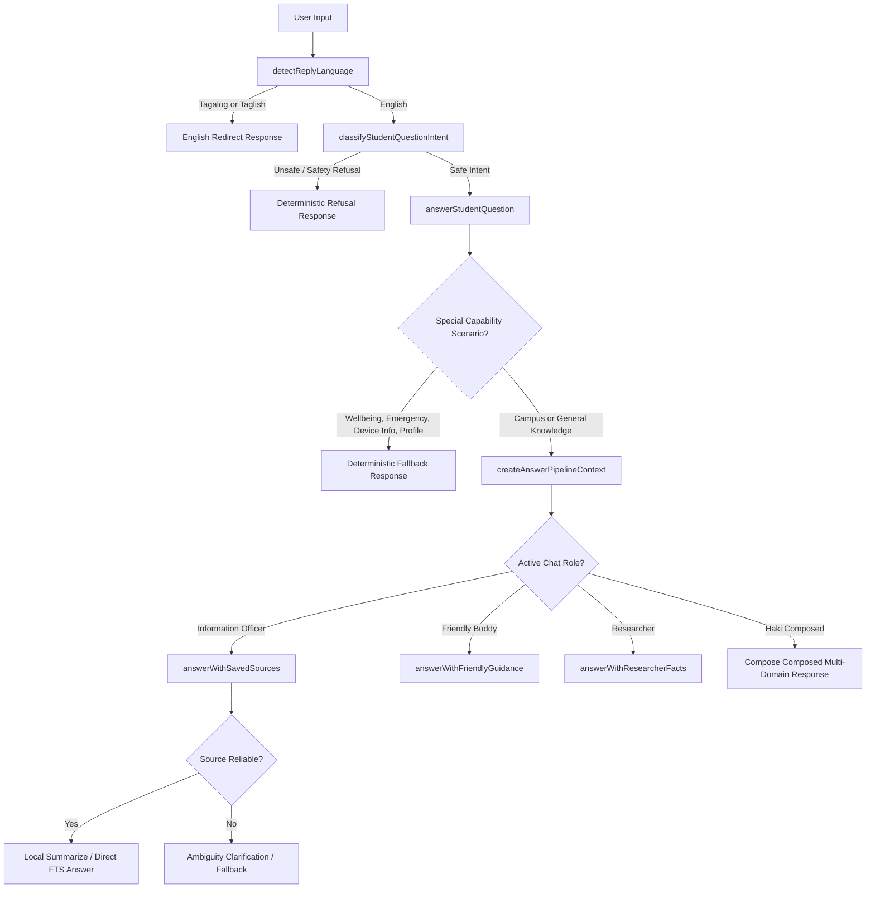

# AGENTS.md

Welcome to the development guide for Haki. This document provides a comprehensive, detailed high-level overview of Haki's architecture, components, query orchestration workflow, offline capability scaling, and operational constraints for engineering agents.

---

## 1. Haki System Overview

Haki is an offline-first, client-only student assistant built with Expo and React Native. It operates entirely on the device without any backend servers, cloud databases, online search APIs, or remote LLM endpoints.

### Core Philosophy
* **Offline-First Grounding**: The application's source of truth is local campus documents containing school processes, office procedures, registrar concerns, etc.
* **Hybrid Retrieval Architecture**: Combines traditional lexical search (SQLite FTS5) with optional vector embeddings and local AI models to retrieve and summarize relevant information.
* **Graceful Degradation**: If advanced local AI features (such as summarization or safe chat) are unavailable or crash due to memory or device limits, Haki seamlessly degrades to a deterministic, local SQLite-only search mode.
* **Data Integrity**: Haki treats [seed-documents.json](file:///c:/Users/joshu/Documents/TUP%20Wiki/src/data/seed-documents.json) as the sole official database source. Mock or unverified campus facts are prohibited.

---

## 2. Directory Structure & Key Modules

The project is structured into distinct, modular layers:

* **`app/`**: Expo Router screens defining the user interface.
  * [chat.tsx](file:///c:/Users/joshu/Documents/TUP%20Wiki/app/chat.tsx): Primary interactive chat UI.
  * [models.tsx](file:///c:/Users/joshu/Documents/TUP%20Wiki/app/models.tsx): Dashboard for GGUF local model downloads, installation, and manual importing.
  * Other screens: `campus-map.tsx`, `canteen.tsx`, `library.tsx`, `profile.tsx`, etc.
* **`src/components/`**: Shared and reusable React Native components.
  * [chat/](file:///c:/Users/joshu/Documents/TUP%20Wiki/src/components/chat/): Chat bubble renderers, speech input indicators, and feedback widgets.
* **`src/ai/`**: Local AI provider logic, capability profiling, prompting, and token management.
  * [LocalAIProvider.ts](file:///c:/Users/joshu/Documents/TUP%20Wiki/src/ai/LocalAIProvider.ts): Abstract interface defining provider tasks.
  * Implementations: [LlamaRnProvider.ts](file:///c:/Users/joshu/Documents/TUP%20Wiki/src/ai/LlamaRnProvider.ts) (runs GGUF files offline using native llama.rn), [AppleFoundationModelsProvider.ts](file:///c:/Users/joshu/Documents/TUP%20Wiki/src/ai/AppleFoundationModelsProvider.ts) (hooks into iOS native Apple Intelligence Foundation Models), [LiteRtLmProvider.ts](file:///c:/Users/joshu/Documents/TUP%20Wiki/src/ai/LiteRtLmProvider.ts), [OnnxGenAiProvider.ts](file:///c:/Users/joshu/Documents/TUP%20Wiki/src/ai/OnnxGenAiProvider.ts), and [FallbackProvider.ts](file:///c:/Users/joshu/Documents/TUP%20Wiki/src/ai/FallbackProvider.ts).
  * [CapabilityDetector.ts](file:///c:/Users/joshu/Documents/TUP%20Wiki/src/ai/CapabilityDetector.ts): Assesses system RAM, storage, ABI, thermal state, and GGUF paths to evaluate active capabilities.
  * [modeSelectionPolicy.ts](file:///c:/Users/joshu/Documents/TUP%20Wiki/src/ai/modeSelectionPolicy.ts): Sesison mode policy selecting the best safe operational configuration.
  * [prompts.ts](file:///c:/Users/joshu/Documents/TUP%20Wiki/src/ai/prompts.ts): Host templates for system framing, strict summaries, and safe chat.
  * [tokenBudget.ts](file:///c:/Users/joshu/Documents/TUP%20Wiki/src/ai/tokenBudget.ts): Manages input and output budgets to prevent local LLM context limits or OOM errors.
* **`src/retrieval/`**: Lexical, semantic, and hybrid search mechanics.
  * [FTSRetriever.ts](file:///c:/Users/joshu/Documents/TUP%20Wiki/src/retrieval/FTSRetriever.ts): Performs full-text search against the SQLite virtual table using BM25 ranking.
  * [VectorRetriever.ts](file:///c:/Users/joshu/Documents/TUP%20Wiki/src/retrieval/VectorRetriever.ts): Performs vector search using generated local text embeddings.
  * [HybridRetriever.ts](file:///c:/Users/joshu/Documents/TUP%20Wiki/src/retrieval/HybridRetriever.ts): Fuses FTS5 and vector search results using Reciprocal Rank Fusion (RRF) and custom weighting.
  * [confidence.ts](file:///c:/Users/joshu/Documents/TUP%20Wiki/src/retrieval/confidence.ts): Classifies search result confidence based on query matches.
  * [queryNormalizer.ts](file:///c:/Users/joshu/Documents/TUP%20Wiki/src/retrieval/queryNormalizer.ts) & [synonymIndex.ts](file:///c:/Users/joshu/Documents/TUP%20Wiki/src/retrieval/synonymIndex.ts): Text preprocessing and mapping.
* **`src/db/`**: Local SQLite database and schema.
  * [schema.ts](file:///c:/Users/joshu/Documents/TUP%20Wiki/src/db/schema.ts): SQLite table schemas for `documents`, `chunks`, virtual `chunks_fts` (FTS5), vector `chunk_embeddings`, and `app_meta`.
  * [seed.ts](file:///c:/Users/joshu/Documents/TUP%20Wiki/src/db/seed.ts): Ingests the initial bundled JSON documents into the database.
* **`src/services/`**: Orchestration services and pipeline managers.
  * [answerService.ts](file:///c:/Users/joshu/Documents/TUP%20Wiki/src/services/answerService.ts): Primary entry point coordinating intent analysis, retrieval, model inference, safety fallback, and role routing.
  * [questionIntentService.ts](file:///c:/Users/joshu/Documents/TUP%20Wiki/src/services/questionIntentService.ts) & [questionScenarioService.ts](file:///c:/Users/joshu/Documents/TUP%20Wiki/src/services/questionScenarioService.ts): Categorize student intents, filter safety threats, flag capabilities, and map questions to predefined scenarios.
  * [sourceAnswerService.ts](file:///c:/Users/joshu/Documents/TUP%20Wiki/src/services/sourceAnswerService.ts): Manages lexical/semantic search execution and coordinates on-device summarization of fetched passages.
  * [chatCapabilityService.ts](file:///c:/Users/joshu/Documents/TUP%20Wiki/src/services/chatCapabilityService.ts): Implements deterministic responders for device diagnostics, profile variables, image generation placeholders, organization lists, and mental health/emergency guidance.
  * [safeLocalChatService.ts](file:///c:/Users/joshu/Documents/TUP%20Wiki/src/services/safeLocalChatService.ts): Runs safe LLM conversational generation with retrieved local context and token padding.
  * [replyLanguageService.ts](file:///c:/Users/joshu/Documents/TUP%20Wiki/src/services/replyLanguageService.ts): Intercepts Tagalog or Taglish inputs to redirect users to ask in English.
* **`src/hooks/`**: UI state controllers.
  * [useChatMessages.ts](file:///c:/Users/joshu/Documents/TUP%20Wiki/src/hooks/useChatMessages.ts): Core UI orchestrator. Manages message lists, streams response tokens, handles interruption by app background state, recovers failed sessions, stitches long answers, and tracks feedback.

---

## 3. Query Orchestration Workflow

When a student types a question in the chat screen, Haki executes the following pipeline:

### Flow Breakdown:
1. **Language Check**: Input is scanned by `detectReplyLanguage`. Tagalog/Taglish triggers an immediate response requesting English input.
2. **Intent & Safety Classification**: `classifyStudentQuestionIntent` parses the input. If it matches safety rules (e.g. self-harm, violence, hacking, harassment, or cheating), it is rejected.
3. **Deterministic Capability Match**: Evaluated for diagnostic queries (e.g. "what is my profile", "show device specs", or suicidal ideation). If matched, it returns a hardcoded safe response directly.
4. **Role Routing**: `answerStudentQuestion` inspects the requested `ChatRole` to isolate domains:
   * **`information_officer`**: Limited to `campus_information`. Performs FTS5/Hybrid source retrieval and direct snippet delivery.
   * **`friendly_buddy`**: Limited to `supportive_advice`. Runs safety local chat with a friendly tone.
   * **`researcher`**: Limited to `external_fact`. Generates general answers to off-campus facts.
   * **`haki`**: The default role. Performs hybrid domain parsing. Joins source-grounded answers with supportive advice or external facts in a structured format.
5. **Retrieval**: If sourcing campus data, Haki normalized queries and invokes `retrieveSourceAnswerDraft`. It calculates a search confidence (`high`, `medium`, or `low`).
6. **Ambiguity & Mismatch Detection**:
   * If multiple close matches exist (e.g., dental care consultation vs dental treatment), Haki pauses and returns a short clarification question.
   * If there is an office mismatch (e.g., query asks about Registrar, but retrieval returns OSA), Haki halts and clarifies.
7. **Local LLM Execution**:
   * If the device mode supports local summaries, Haki calls the summarization provider using the strict prompt template: *use only provided chunks, do not guess, return NO_RELIABLE_ANSWER if insufficient.*
   * If the model returns `NO_RELIABLE_ANSWER` or fails, Haki falls back to direct FTS5 passage output.
8. **Grounding Output Guard**: Haki runs `validateCampusGroundingQuality` against the generated text to make sure the output only contains facts present in the source evidence. Hallucinations trigger fallbacks.
9. **Continuation**: If the provider returns a truncated response, the hook detects the token cut-off and executes a continuation turn, stitching the outputs seamlessly.

---

## 4. Hardware Adaptive Capability Tiers

Haki automatically detects hardware capability at app startup and stores a `DeviceAIMode` for the session:
1. **`hybrid-local-ai`**: Local embeddings for vector retrieval + local model for summarization/chat.
2. **`local-summary`**: FTS5 retrieval + local model for summarization and safe chat.
3. **`local-safe-chat`**: FTS5 retrieval + local model for safe general chat (no summarization).
4. **`semantic-search`**: Local embeddings + direct FTS5 text delivery (no chat model).
5. **`fts5-only`**: Pure local database search. Zero AI module usage. Required fallback baseline.

### Model Tier Rules
Models are grouped based on parameters and quantization. Activation is gated by detected device hardware to prevent crashes:
* **Tiny** (0.5B - 1.5B)
* **Minimum** (1B - 3B)
* **Good** (3B - 4B)
* **Enhanced** (4B - 7B)
* **Flagship** (7B - 8B)

---

## 5. Development Guidelines (Original Rules Preserved)

The following rules taking precedence over other instructions must be strictly followed when writing code:

### Project Shape
* Expo/React Native app with route screens in `app/`.
* Shared UI lives in `src/components/`; chat-specific UI is in `src/components/chat/`.
* Local AI providers, model selection, token budgeting, and model download/import logic live in `src/ai/`.
* Retrieval and source ranking live in `src/retrieval/`; SQLite schema, migrations, and seed loading live in `src/db/`.
* Student chat orchestration lives mainly in `src/hooks/useChatMessages.ts` and `src/services/answerService.ts`.

### Commands
* Use `npm.cmd` on Windows PowerShell to avoid `npm.ps1` execution-policy failures.
* Typecheck: `npm.cmd run typecheck`
* Retrieval tests: `npm.cmd run test:golden`
* Edge-case tests: `npm.cmd run test:edge-cases`
* Chat scenario tests: `npm.cmd run test:chat-scenarios`
* Local model tests: `npm.cmd run test:local-models`
* Full suite: `npm.cmd run test:all`

### Data Rules
* `src/data/seed-documents.json` is the source of bundled campus data.
* Do not add mock campus facts, fake fees, fake office locations, or invented deadlines.
* If source data changes, update `SEED_VERSION` in `src/db/seed.ts` so installed apps reseed.
* Keep tests aligned to real chunk IDs and real office names from the seed file.

### Chat And AI Rules
* Haki should answer in English only. Tagalog/Taglish user input should be redirected to English, not translated into an answer.
* Preserve actor roles exactly. Do not swap what the user, teacher, office, company, or classmate needs.
* Ask one short clarification question when intent or pronoun references are ambiguous.
* Fetch persistent prior conversation context only when it is related; avoid attaching unrelated history.
* Keep local model activation conservative. Do not auto-activate models above the detected safe device tier.

### Engineering Notes
* Follow existing architecture and UI conventions before adding new abstractions.
* Do not revert or overwrite unrelated dirty worktree changes.
* Prefer focused tests that cover the specific behavior changed.
* Use `apply_patch` for manual edits.

