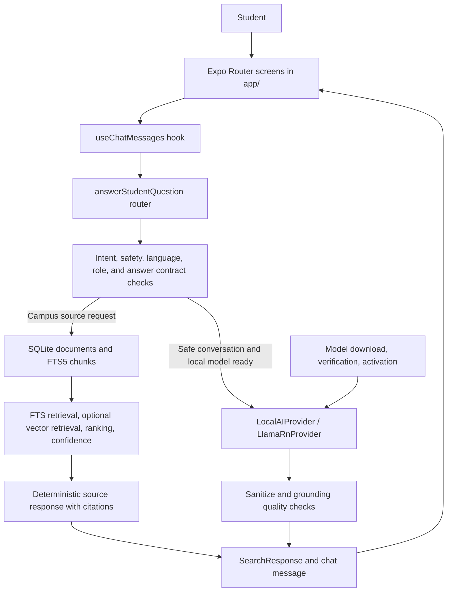
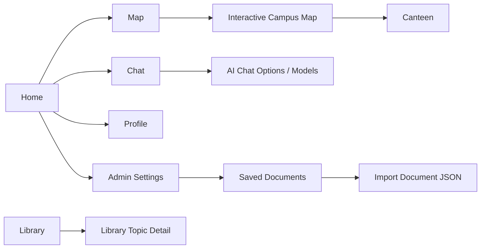
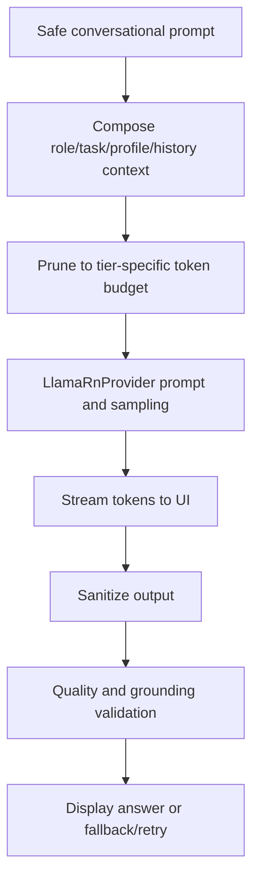

# Building Haki From Scratch

## A Beginner's Guide to a Mobile, Offline-First AI Assistant

This guide explains the current Haki/TUP Wiki codebase as an engineering system, not as a marketing demo. It is written for someone learning both mobile development and AI engineering, and it is also structured so you can later explain the design in an interview.

The most important fact to understand is this:

> Haki is not just a chat screen attached to a language model. It is an offline-first mobile application that combines local source retrieval, deterministic answer rules, optional on-device language generation, device-aware model management, privacy controls, and safety boundaries.

The implementation described here was inspected from the project source tree as it exists on May 24, 2026. When the app's bundled content or AI implementation changes, this guide should be updated with the code.

---

## Table of Contents

1. [The Project In One View](#1-the-project-in-one-view)
2. [What Is Trusted, Generated, Or Placeholder Data](#2-what-is-trusted-generated-or-placeholder-data)
3. [How The Whole App Is Connected](#3-how-the-whole-app-is-connected)
4. [Complete Codebase Responsibility Map](#4-complete-codebase-responsibility-map)
5. [The AI System: What Haki Actually Does](#5-the-ai-system-what-haki-actually-does)
6. [One Message From Tap To Answer](#6-one-message-from-tap-to-answer)
7. [Building The App From Scratch, Step By Step](#7-building-the-app-from-scratch-step-by-step)
8. [Building The AI Capability In Depth](#8-building-the-ai-capability-in-depth)
9. [Testing, Debugging, And Release Confidence](#9-testing-debugging-and-release-confidence)
10. [How To Explain Haki In An Interview](#10-how-to-explain-haki-in-an-interview)
11. [Current Limitations And Sensible Next Work](#11-current-limitations-and-sensible-next-work)

---

# 1. The Project In One View

## 1.1 What Haki is

Haki is an Expo/React Native mobile app for TUP-Taguig students. Its central experience is a student assistant that can:

- search locally bundled campus procedure information;
- answer from saved sources with visible evidence;
- expose four intentional chat modes: source-bounded campus information, supportive guidance, outside-campus research, and a default orchestrating mode;
- offer optional generated guidance or outside-campus explanations through a downloaded local language model;
- remember only relevant previous conversation context;
- protect private profile data;
- handle voice input, feedback, onboarding, model downloads, and administrative document import;
- operate without a remote chat API.

The app also has non-chat screens for the campus map, library topics, tips, organization displays, canteen browsing, profile management, settings, and model management.

## 1.2 The central engineering decision

There are two very different kinds of answer:

| Question type | Example | Correct engineering approach |
| --- | --- | --- |
| Campus procedure or local fact | "Where do I report a lost ID?" | Retrieve saved source chunks and answer deterministically from them. |
| Friendly support or general conversation | "I am stressed about exams." | If a safe local model is installed, generate bounded conversational guidance. |

Why separate these?

A language model is good at phrasing, conversation, and broad guidance, but it can confidently invent a fee, deadline, office, or procedure. A campus assistant cannot treat an invented process as an acceptable mistake. Haki therefore keeps source-backed campus answers anchored to stored documents, while it uses the local model only where generation is appropriate and guarded.

**Analogy:** A helpful student volunteer may be great at encouraging you, but official enrollment instructions should be read from the registrar's document, not recalled from memory.

## 1.3 Offline-first does not mean "no download ever"

Haki has two levels of offline capability:

| Capability | Available without downloading an AI model? | Network needed at use time? |
| --- | --- | --- |
| Source search and campus source answers | Yes | No |
| Deterministic utility, safety, and fallback answers | Yes | No |
| Friendly/local generated conversation | No, a compatible GGUF model must first be downloaded or imported | No after model installation |
| Optional semantic embeddings | Only if an embedding provider/model becomes available | No after availability |

A user may need internet once to download a curated local chat model. Actual inference then happens on the phone.

## 1.4 A beginner's mental model

Think of Haki as a small campus help desk with several workers:

| System part | Analogy | Code area |
| --- | --- | --- |
| React Native screens | The front counter and forms a student sees | `app/`, `src/components/` |
| Chat hook | The clerk who records each turn and updates the screen | `src/hooks/useChatMessages.ts` |
| Intent and answer router | The receptionist deciding which desk handles a question | `src/services/answerService.ts`, intent services |
| SQLite + FTS retrieval | The filing cabinet and fast index of saved documents | `src/db/`, `src/retrieval/` |
| Deterministic source formatter | The employee reading the approved document aloud | `src/services/sourceAnswerService.ts` |
| On-device model | A conversational tutor available only after installation | `src/ai/LlamaRnProvider.ts` |
| Model manager | The technician who downloads, verifies, tests, and activates models | `src/ai/localModelManager.ts` |
| Safety, language, grounding checks | Office policies preventing harmful or invented advice | `src/services/`, `src/ai/outputQuality.ts` |

This layered design is the AI engineering. The model is one worker, not the entire company.

---

# 2. What Is Trusted, Generated, Or Placeholder Data

Before building an AI assistant, define what it is allowed to claim. This is called a **data trust boundary**.

## 2.1 Bundled source corpus

`src/data/seed-documents.json` is the source of bundled campus document chunks. In the current tree it contains 6 documents and 24 chunks, covering areas such as:

- TUP-Taguig Clinic procedures;
- Guidance and Counselling Office procedures;
- Office of the Student Affairs procedures;
- campus safety;
- feedback or complaints;
- campus policies.

The database seed process loads these chunks for retrieval. If the seed data is changed, `SEED_VERSION` in `src/db/seed.ts` must change so installed apps receive the updated content.

For production use, content owners must verify this source material and keep it current. The software can retrieve faithfully only what has been stored faithfully.

## 2.2 Generated answers

Generated text comes from a local model only in selected conversational paths. It must not silently become the authority for campus procedures. The normal official campus path produces its answer directly from retrieved content, not by asking the model to rewrite the policy.

## 2.3 UI datasets that are not official answer sources

Several local datasets support screens or demonstrations but must not be presented as verified official campus facts unless the data is later validated:

| Data file | Role in the application | Trust note |
| --- | --- | --- |
| `src/data/canteenStores.ts` | Canteen browsing and local canteen response formatting | Contains replaceable menu/pricing data; prices and availability may change. |
| `src/data/organizationOfficers.ts` | Officer display/chat response support | Explicitly marked mock. |
| `src/data/orgChart.ts` | Organization chart visualization | Explicitly realistic mock data. |
| `src/data/organizationGroups.ts` | Organization browsing cards | Display data requiring verification before official use. |
| `src/data/campusMapDestinations.ts` and `campusMapGameplay.ts` | Interactive campus navigation UI | Uses confirmed or deliberately limited mappings; it avoids inventing unconfirmed room placement. |
| `src/data/studentTips.ts` | General student tip cards | UI content, not retrieved campus procedure evidence. |

This distinction matters in interviews: you should be able to say which information is evidence-backed, which text is generated, and which features use display content only.

---

# 3. How The Whole App Is Connected

## 3.1 High-level architecture



## 3.2 Startup flow

The app starts in `app/_layout.tsx`. This file is more than navigation layout: it coordinates application lifecycle behavior.

At startup it:

1. Determines whether onboarding should be shown.
2. Cleans incomplete local model downloads and attempts operation recovery.
3. Initializes or refreshes AI mode detection.
4. Resets admin state so administrative access is not unintentionally preserved.
5. Renders the tab navigation and the global model-operation indicator.

When the app moves to the background it:

1. pauses a running model download;
2. releases local AI contexts to reduce memory pressure;
3. disables admin mode.

**Why this matters:** phones have constrained RAM and applications are suspended often. A mobile AI app must be a good memory citizen, not merely a desktop script placed inside a phone UI.

## 3.3 Main screen relationships



The tab bar exposes the everyday student areas. Several administrative, detail, setup, and AI management routes are intentionally reached through buttons rather than as top-level tabs.

---

# 4. Complete Codebase Responsibility Map

This section maps the project-owned source, native, build, and test files. Generated build output, installed packages, and individual image/font binaries are intentionally excluded because they do not explain how Haki is engineered.

## 4.1 Application routes: `app/`

| File | Responsibility |
| --- | --- |
| `_layout.tsx` | Root navigation, first-run onboarding gate, app lifecycle reactions, admin reset, AI/model recovery, global operation badge. |
| `index.tsx` | Home dashboard, navigation cards, typed trivia lines, profile/admin entry points. |
| `chat.tsx` | Student chat screen, four-mode selector, switch-and-answer actions, keyboard-aware composer, voice entry, message list. |
| `models.tsx` | Public local chat-model catalog and installed model controls: download, pause/resume, activate, remove. |
| `onboarding.tsx` | Six-step first-run or edit flow for student profile setup. |
| `profile.tsx` | Profile editing, avatar selection, model screen link. |
| `map.tsx` | Entry screen for the campus map experience; its preview crop is focused on the open court. |
| `campus-map.tsx` | Interactive map gameplay/search, static directional gray-hawk player poses, and local destination navigation. |
| `canteen.tsx` | Canteen store list and search. |
| `canteen-store/[storeId].tsx` | Canteen store menu/detail route. |
| `library.tsx` | Searchable browsing of seed document topics. |
| `library-topic/[chunkId].tsx` | Detail view for one library/source topic chunk. |
| `tips.tsx` | Student tips browsing and filtering. |
| `organization.tsx` | Organization group display. |
| `org-chart.tsx` | Interactive organization chart visualization. |
| `settings.tsx` | Thin route exporting the settings screen component. |
| `documents.tsx` | Admin-only document inventory. |
| `add-document.tsx` | Admin-only JSON document validation/import flow. |

## 4.2 Core AI layer: `src/ai/`

| Files | Responsibility |
| --- | --- |
| `LocalAIProvider.ts`, `DeviceAIMode.ts` | Shared contracts: what a provider can do and what AI mode the app selected. |
| `providerRegistry.ts`, `providerUtils.ts`, `nativeModules.ts` | Provider construction, utility handling, and access to optional native bridges. |
| `CapabilityDetector.ts`, `modeSelectionPolicy.ts`, `deviceHardwareProfile.ts` | Inspect device/runtime/model readiness and choose the safest usable capability. |
| `FallbackProvider.ts` | No-model baseline so the app remains useful through source retrieval. |
| `LlamaRnProvider.ts`, `llamaRnRuntime.ts`, `llamaStoppedLimit.ts`, `localModelPerformance.ts` | GGUF inference through `llama.rn`, cancellation, bounded streaming, token-limit detection, and benchmarked CPU/Metal/OpenCL profile selection. |
| `AppleFoundationModelsProvider.ts` | iOS 26+ Apple Foundation Models provider boundary with real native availability checks and source-summary citation validation. |
| `localModelManager.ts`, `localModelMetadata.ts`, `localModelRequirements.ts`, `modelDownloadConfig.ts` | Curated downloads, provenance/policy metadata, SHA-256 verification, GGUF validation, hardware tiers, benchmarked activation, removal, and inference leases. |
| `localModelEvaluation.ts` | Administrator-triggered, on-device behavioral evaluation of the active generated-chat model, persisted locally for diagnostics. |
| `prompts.ts`, `tokenBudget.ts`, `sanitizeAssistantText.ts`, `outputQuality.ts` | Prompt rules, context limits, output cleanup, and hallucination/degeneracy protection. |
| `llamaStoppedLimit.test.ts` | Unit tests for incomplete local output detection. |

## 4.3 Data storage and retrieval

| Area | Files | Responsibility |
| --- | --- | --- |
| Database | `src/db/database.ts`, `schema.ts`, `migrationRunner.ts`, `documentRepository.ts`, `ftsHealth.ts`, `seed.ts`, `chunkEmbeddingBackfill.ts` | Open SQLite, migrate tables, seed source chunks, maintain FTS, read/import documents, and store versioned per-model embeddings/status. |
| Legacy/minimal migration module | `src/db/migrations.ts` | Retained migration-related module; current database startup uses `migrationRunner.ts`. |
| Retrieval contract and text search | `src/retrieval/Retriever.ts`, `FTSRetriever.ts`, `queryNormalizer.ts`, `synonymIndex.ts`, `ranking.ts`, `confidence.ts` | Query parsing, FTS matching, domain aliases, result ranking, reliability classification. |
| Semantic/hybrid retrieval | `src/retrieval/VectorRetriever.ts`, `VectorRetriever.placeholder.ts`, `HybridRetriever.ts`, `HybridRetriever.placeholder.ts`, `rrf.ts` | Optional embedding similarity search and reciprocal-rank fusion. The current vector path scans stored candidate embeddings in memory rather than using a scalable vector index. |
| Test retriever | `src/retrieval/InMemoryCorpusRetriever.ts` | Deterministic retrieval for scripts/tests without a device database. |

## 4.4 Chat orchestration and application services: `src/services/`

| Files | Responsibility |
| --- | --- |
| `answerService.ts`, `answerContractService.ts`, `studentChatTypes.ts` | Central routing and behavioral contracts for every question. |
| `questionIntentService.ts`, `questionScenarioService.ts`, `replyLanguageService.ts` | Safety classification, scenario/scope recognition, and English-only response policy. |
| `sourceAnswerService.ts`, `sourceChunkAdapter.ts`, `searchResultText.ts` | Retrieval orchestration, reliable deterministic campus answer construction, source conversion, display formatting. |
| `safeLocalChatService.ts`, `chatRoleService.ts`, `chatCapabilityService.ts`, `scenarioResponseService.ts`, `modelRefusalUtils.ts`, `refusalResponseBuilder.ts` | Local generated conversation, role boundaries, deterministic helpers, generation refusal retry, and safety responses. |
| `modeSelectionService.ts` | Service-level caching/refreshing of selected provider mode and memory-pressure cleanup. |
| `conversationStateService.ts`, `chatConversationContext.ts`, `chatFollowUpDetection.ts`, `chatContinuation.ts`, `chatArithmeticShortcut.ts`, `historyService.ts` | Related context retrieval, actor tracking, follow-up handling, continuation, and persisted conversation memory. |
| `studentProfileService.ts`, `onboardingService.ts`, `adminService.ts` | Protected profile data, onboarding state, and restricted admin access. |
| `chatFeedbackService.ts` | Locally retained thumbs-up/down response feedback. |
| `speechRecognitionAdapter.ts`, `speechToTextService.ts`, `nativeVoiceModuleGuard.ts`, `voiceSettingsService.ts` | Voice-input abstraction, native/web support checks, and autosend preference. |
| `canteenAnswerService.ts`, `mascotDialogueService.ts`, `triviaService.ts`, `documentImportService.ts` | Feature-specific local responses/content and administrative JSON import. |
| `answerService.chatRoles.test.ts`, `chatRoleService.test.ts`, `chatFollowUpDetection.test.ts`, `scenarioFallbackResponses.test.ts`, `studentProfileService.test.ts` | Service behavioral tests. |

## 4.5 Hooks, components, types, data, theme, and utilities

| Area | Files and role |
| --- | --- |
| Hooks | `src/hooks/useChatMessages.ts` owns live conversation state/orchestration; `useVoiceInput.ts` manages transcription; `useDebouncedQuery.ts` and `useReducedMotion.ts` support UI behavior. |
| Chat UI | `src/components/chat/ChatInputBar.tsx`, `ChatMessageBubble.tsx`, `ChatRoleSelector.tsx`, `ChatSourceCard.tsx`, and `FeatherLoader.tsx` show a keyboard-safe composer, animated mode selection, waiting state, four roles, switch actions, citations, feedback, retry, and continuation. Response bubbles do not expose internal answer-basis badges. |
| Model/UI support | `src/components/models/ModelOperationBadge.tsx`, `ModelOperationHaki.tsx`, `AdminGate.tsx`, `AdminUnlockModal.tsx`, and `ErrorBoundary.tsx`. |
| Settings UI | `src/components/settings/SettingsScreen.tsx`, `SettingsCapabilitySection.tsx`, `SettingsDbSection.tsx`, and `SettingsPreferencesSection.tsx`; administrator capability details can run and display the active-model evaluation. |
| Mascot UI | `src/components/mascot/PixelHaki.tsx`, `mascotConfig.ts`, `useMascotInteraction.ts`, and `src/components/MascotHeader.tsx`; the header renders a red bold `Did you know?` label only for trivia dialogue and uses an avian gray-hawk sprite set with a uniform-mounted TUP-style patch. |
| General presentation UI | `src/components/SuggestedQuestions.tsx`, `HakiTabPopup.tsx`, `ConfidenceBadge.tsx`, `ModeStatusBadge.tsx`, `MatchedExcerpt.tsx`, and `QuestionInput.tsx`. |
| Organization chart UI | `src/components/orgChart/orgChartLayout.ts` and `orgChartLayout.test.ts`. |
| Domain types | `src/types/document.ts`, `chat.ts`, `search.ts` define data, messages, results, chat roles, answer basis, and citations. |
| App data | `src/data/seed-documents.json`, `golden-questions.json`, `libraryTopics.ts`, `canteenStores.ts`, `organizationGroups.ts`, `organizationOfficers.ts`, `orgChart.ts`, `studentTips.ts`, `campusMapDestinations.ts`, `campusMapGameplay.ts`, `appRepository.ts`. |
| Data tests | `src/data/campusMapDestinations.test.ts`, `campusMapGameplay.test.ts`. |
| Theme | `src/theme/colors.ts`, `metrics.ts`, `typography.ts`. |
| Utilities | `src/utils/constants.ts`, `aiUtils.ts`, `fileSha256.ts`, `logger.ts`, `validation.ts`, `onboardingState.ts`, `onboardingState.test.ts`. |
| Broad pure tests | `src/__tests__/pure-modules.test.ts` covers token limits, retrieval scoring, sanitizing, intent/language, and trivia. |

## 4.6 Native modules, scripts, assets, and configuration

| Area | Files and purpose |
| --- | --- |
| Android native helper | `android/app/src/main/java/com/tupt/haki/HakiDeviceInfoModule.kt`, `HakiDeviceInfoPackage.kt`, `MainApplication.kt`, `MainActivity.kt` provide native registration plus RAM/ABI/thermal detection and streamed SHA-256 hashing. |
| Android build integration | `android/app/build.gradle`, `android/gradle.properties`, and `android/app/src/main/AndroidManifest.xml` configure the Android build/runtime permissions and native packaging behavior. |
| iOS native modules | `modules/haki-apple-foundation-models/ios/HakiAppleFoundationModelsModule.swift` exposes real iOS 26+ Foundation Models generation; `modules/haki-device-info/ios/HakiDeviceInfoModule.swift` reports RAM/thermal state and streams SHA-256 for curated GGUF installation. |
| Evaluation scripts | `scripts/golden-retrieval.ts`, `chat-scenario-eval.ts`, `test-edge-cases.ts`, `test-local-model-manager.ts` validate retrieval, behavioral rules, quality failures, and model policy. |
| Build guard scripts | `scripts/inspect-apk-assets.ps1`, `eas-build-pre-install.sh`, `fix-expo-sqlite.js` check APK/model packaging and patch SQLite build compatibility. |
| Main configuration | `package.json`, `app.json`, `tsconfig.json`, `babel.config.js`, `metro.config.js`, `vitest.config.ts`, `eas.json` configure Expo, TypeScript, native plugins, tests, bundling, and EAS builds. |
| Native/build configuration | `android/` Gradle/manifest resources and local module files; `patches/` contains dependency compatibility patches used at install/build time. |
| Visual assets | `assets/` contains images, animations, fonts, and mascot/UI art; it does not contain bundled GGUF chat model weights. |
| Guidance/docs | `AGENTS.md`, `README.md`, and this guide in `docs/`. |

---

# 5. The AI System: What Haki Actually Does

## 5.1 "AI" is the complete decision pipeline

Beginners often assume AI means `send question -> LLM -> show answer`. Haki's practical AI pipeline is closer to:

```text
question
  -> classify safety, language, scenario, source scope, and role
  -> decide whether this is a source answer or a conversational answer
  -> retrieve evidence if it concerns campus information
  -> optionally invoke a local model for safe conversation only
  -> sanitize and validate output
  -> show answer, provenance, and sources
  -> remember limited related context and optional feedback
```

Every arrow is an engineering choice. In an AI product, reliable behavior normally comes from the system surrounding the model.

## 5.2 Retrieval-Augmented Generation, adjusted for safety

The usual term **RAG** means Retrieval-Augmented Generation:

1. Retrieve useful documents.
2. Give them to a language model.
3. Ask the model to write the answer.

Haki is more conservative for official campus answers:

1. Retrieve useful document chunks.
2. Rank and check confidence.
3. Construct the official answer deterministically from the retrieved chunk.
4. Attach source metadata and confidence metadata. User-facing verification guidance is shown once in the persistent chat notice rather than repeated inside answer bubbles.

There is code in `sourceAnswerService.ts` capable of provider-backed source summarization, but the main production route in `answerService.ts` uses the deterministic official response path for campus source answers.

**Why:** If the source says "submit X" and a model creatively adds "pay PHP 100," the answer becomes harmful even if it sounds polished. Deterministic source construction trades conversational elegance for truthfulness.

## 5.3 The four Haki modes

The UI exposes four roles through `ChatRoleSelector`, while `answerService.ts` and `chatRoleService.ts` enforce what each role may answer:

| Role | What it may answer | What it must not do | Without a safe local model |
| --- | --- | --- | --- |
| `haki` / Haki | Default orchestrator: campus facts from saved sources, supportive guidance, and outside-campus explanations when applicable. | Never invent campus information. | Remains selected; campus/source and deterministic safety/app paths work, while generated needs show model setup guidance. |
| `information_officer` / Information Officer | Campus information found in the saved database only. Its persistent notice asks users to verify important details with the relevant office. | No personal-advice answer and no outside-campus factual answer. | Fully available because the authoritative path is retrieval plus deterministic formatting. |
| `friendly_buddy` / Friendly Buddy | Empathetic, psychologically informed personal support. | Does not claim to be a psychologist, therapist, or PhD; does not diagnose; does not provide campus facts or research answers. | Requires local generated chat; otherwise explains model setup. |
| `researcher` / Researcher | General facts outside campus. Its persistent top notice reminds students to verify important facts. | No TUPT campus procedures or personal-support answer. | Requires local generated chat; otherwise explains model setup. |

`Haki` is the default because it first classifies the user's context and then dispatches only the necessary work. For a mixed request, it may compose clearly labeled blocks: a deterministic campus block, a supportive block, and a general-information block. Only the campus block carries campus source cards.

Specialized modes do not quietly answer outside their scope. Their restriction stays visible in the top notice, while an out-of-scope question returns `suggestedModeActions`, rendered as buttons such as **Switch to Researcher and answer**. Pressing one changes mode and immediately submits the same question again.

When Information Officer cannot retrieve a supported campus answer, it uses varied but consistent wording that says the information is not yet in Haki's database and asks the student to report the gap to `hakiadmin@gmail.com`.

## 5.4 Safety and language are decided before model generation

`questionIntentService.ts` identifies safety categories such as self-harm, violence, cyber abuse, private-data misuse, harassment, sexual exploitation, academic dishonesty, and illegal requests. Deterministic responses are used for unsafe requests instead of relying on model judgment.

The app also has an English-only Haki answer policy. Tagalog or Taglish student questions are detected and redirected to English rather than answered in Tagalog or Taglish. This rule is enforced at the central answer router before ordinary model/source responses.

For ambiguous intent or pronoun references, Haki asks one short clarification question instead of guessing who or what the student meant.

## 5.5 Local generation is capability-driven

The `LocalAIProvider` interface prevents the rest of the application from assuming that one AI runtime is always available. A provider declares whether it supports:

- safe chat;
- summarization;
- embeddings;
- reranking or related capability reporting;
- streaming and cancellation behavior;
- installed model readiness and hardware information;
- selected execution backend, acceleration decision, benchmark metrics, and thermal state.

`CapabilityDetector.ts`, `modeSelectionPolicy.ts`, and `modeSelectionService.ts` select an AI mode:

| Mode idea | Behavior |
| --- | --- |
| FTS5/source-only baseline | Local text search and deterministic source responses work even with no LLM. |
| Semantic or hybrid search | Embedding support adds similarity results and fuses rankings. |
| Local safe chat/summary | A compatible local provider can perform generation. |
| Fallback | Features continue safely when providers fail or are unavailable. |

The baseline database and FTS capability is checked first because retrieval is the product's dependable foundation.

## 5.6 Local models are managed assets, not app-bundled weights

Haki does not ship a large GGUF chat model inside the APK. It manages models after installation:

```text
models/chat/library.json
models/chat/installed/<model-id>/model.gguf
models/chat/installed/<model-id>/manifest.json
models/chat/staging/<operation-id>.partial.gguf
models/chat/staging/<operation-id>.json
```

The model workflow is:

1. Detect device RAM, architecture, storage, thermal state, and compatible tier.
2. Display curated, hashed download choices that fit Android or iOS hardware.
3. Download into staging rather than treating a partial file as installed.
4. Verify expected SHA-256.
5. Inspect GGUF metadata, prompt-template family, artifact provenance, and generation policy.
6. Reject incompatible or unsafe activation candidates.
7. Benchmark a CPU baseline and a supported Metal/OpenCL candidate; retain acceleration only when it is measurably faster without unsafe thermal state.
8. Store the selected execution profile and expose it in administrator capability details.
9. Use an inference lease so a model cannot be removed during an active completion.

**Analogy:** Installing a local model is like fitting an engine into a vehicle. You check that the engine fits, verify it came from the expected supplier, test that it starts, and only then let the driver use it.

## 5.7 The local model runtime

`LlamaRnProvider.ts` integrates downloadable GGUF models through `llama.rn`. On eligible iOS 26+ devices, `AppleFoundationModelsProvider.ts` can instead use Apple's system-managed on-device model after its native availability check succeeds. FTS5 remains the baseline when neither provider is ready.

The GGUF provider:

- loads the activated GGUF model;
- selects context size, batch size, threads, and the persisted CPU/Metal/OpenCL execution profile based on measured device behavior;
- builds system/task/profile/history/source prompt context;
- applies input and output token budgets;
- streams partial tokens to the UI unless the model policy requires final-output sanitization;
- accepts cancellation through an abort signal;
- retries degenerate repetitive output using stricter sampling;
- returns whether generation was incomplete because a token limit stopped it;
- allows only source citation IDs that were actually provided to the model;
- forces Qwen3 catalog models into non-thinking mode and strips/refuses reasoning-tag output before display;
- exposes embeddings when an embedding model is configured.

This is mobile AI engineering: a useful model must fit memory, produce bounded output, respond progressively, stop on demand, and fail without damaging the user experience.

## 5.8 Embeddings and hybrid retrieval

FTS search works well when a student's words overlap the source text. Embeddings are useful when wording differs but meaning is similar.

The optional flow is:

```text
saved chunk text -> embedding model -> float vector stored in chunk_embeddings
new question -> query embedding -> cosine similarity against saved vectors
FTS ranked list + vector ranked list -> reciprocal rank fusion -> confidence check
```

`chunkEmbeddingBackfill.ts` populates stored chunk embeddings only when an embedding-capable provider is available. Embeddings and generation status are keyed by both `chunk_id` and `model_name`, so changing an embedding model does not overwrite or permanently suppress another model's vectors. The current vector retriever is functional but scans stored candidates in memory, which is acceptable for the current 25-chunk corpus and not yet a scalable nearest-neighbor architecture.

## 5.9 Context, memory, and privacy

Haki uses context carefully:

- `historyService.ts` stores limited recent conversation memory and retrieves earlier history only when it is relevant by lexical/scenario/scope signals.
- `conversationStateService.ts` tracks actors such as user, teacher, classmate, office, or company so a follow-up does not accidentally swap roles.
- `chatConversationContext.ts` prunes current turns to the token budget.
- `studentProfileService.ts` stores sensitive profile information in `expo-secure-store` where available, with an avatar in application file storage.
- Profile context explicitly tells generated chat not to repeat student ID/course/year/section unless the user asks.

**Analogy:** Good memory is not throwing every notebook you own onto a desk. It is bringing only the relevant page, while keeping confidential records closed unless they are needed.

---

# 6. One Message From Tap To Answer

## 6.1 A campus source question

Suppose the user asks an official procedure question.

1. `app/chat.tsx` receives the message through the input component.
2. `useChatMessages.ts` adds the optimistic user message and prepares cancellation, context, actor state, profile context, and streaming callbacks.
3. It calls `answerStudentQuestion(...)` in `src/services/answerService.ts`.
4. Intent classification determines that the question needs campus source context and may set an office/document scope.
5. Safety and English-only policy are applied before any generated answer.
6. `sourceAnswerService.ts` calls FTS retrieval, and optionally vector/hybrid retrieval when available.
7. Results are ranked and assigned a reliability/confidence result.
8. If the source is ambiguous or mismatched, Haki asks a focused clarification or reports no reliable saved source rather than guessing.
9. If reliable, `buildDeterministicSourceResponseFromDraft(...)` builds an answer from source content and attaches citations/provenance.
10. The chat bubble renders the answer and `ChatSourceCard` can expose the source evidence.

No local language model is required for this path.

## 6.2 A safe supportive question

Suppose the user selects Friendly Buddy and asks for study encouragement.

1. The same central router classifies the prompt as a safe support request.
2. `chatRoleService.ts` verifies that support is inside Friendly Buddy's allowed domain.
3. Without a ready model, Friendly Buddy remains the selected mode but responds that local chat setup is needed; the app does not pretend that another mode answered.
4. With a ready model, `safeLocalChatService.ts` selects the Friendly Buddy prompt, which requires empathetic support but prohibits clinical credentials, diagnosis, campus facts, or research answers.
5. `LlamaRnProvider.ts` builds a compact prompt, applies token budgets, and streams generation.
6. The output is sanitized and checked for campus-information leakage. If it introduces procedure details, the generated portion is replaced by a bounded safe fallback.
7. The hook updates the live assistant bubble and stores limited response metadata/feedback capability.

## 6.3 A researcher question

Suppose the user selects Researcher and asks what photosynthesis is.

1. The router detects an outside-campus fact domain.
2. With a local model, the Researcher-specific prompt allows a concise factual explanation while prohibiting TUPT procedures and personal counseling.
3. The top-of-chat Researcher notice remains visible and states the fact-checking limitation once, instead of repeating a disclaimer inside every response.
4. If the question is about a campus process instead, Researcher does not answer it; the UI offers a switch-and-answer action for Information Officer or default Haki.

## 6.4 A mixed emotional and campus question

If a student is stressed **and** needs a campus process, default `Haki` may compose two clearly separate parts:

- generated supportive guidance, constrained not to invent official instructions;
- a deterministic campus-source answer with its evidence.

If the same question also asks for outside-campus facts, a Researcher-style general-information block can be added while default Haki's top notice communicates the accuracy limitation once. In a specialized mode, Haki answers only the portion allowed by that mode and offers mode-switch buttons for the omitted portions.

## 6.5 Failure behavior is part of the design

| Failure or risk | Haki behavior |
| --- | --- |
| No model installed | Keep default `Haki` selected and keep source/deterministic paths working; requests needing Friendly Buddy or Researcher generation receive setup guidance. |
| Provider errors while generating | Disable failed provider for the session where appropriate, reselect mode, retry within limits, or return a safe fallback. |
| User presses stop | Abort local generation and retain a coherent partial/incomplete state. |
| Answer cut off at output token limit | Mark incomplete and offer continuation stitching. |
| Retrieved result is weak or wrong-office | Do not show it as reliable official guidance; clarify or report missing source. |
| Model emits suspicious campus facts | Replace or constrain using source-backed handling. |
| Unsafe request | Return a specific deterministic protective response. |
| Tagalog/Taglish input | Redirect the student to ask in English; Haki answers in English only. |

---

# 7. Building The App From Scratch, Step By Step

This part teaches the build sequence. Each step answers four questions:

- **What are we building?**
- **Why is it needed?**
- **Where does this project implement it?**
- **How do we know the step works?**

## Step 0: Define the product rules before writing UI

### What you build

Write down behavioral contracts:

- official campus facts must come from saved source chunks;
- local model generation is optional and cannot invent procedure details;
- English-only assistant response policy;
- safe handling of harmful requests;
- one short clarification for unclear references;
- no activation of models beyond the device's safe tier;
- private profile details must not be casually repeated.

### Why you need it

Without contracts, a feature team will implement conflicting behavior: one screen may allow a model to state fees, another may display unverified information as official, and tests will not know what "correct" means.

### Project files

- `AGENTS.md`
- `src/services/answerContractService.ts`
- `src/services/studentChatTypes.ts`
- `src/types/search.ts`

### Checkpoint

You can explain which answers require evidence and which answers may be generated.

## Step 1: Create the Expo and React Native shell

### What you build

Create an Expo Router app with TypeScript and route screens. Configure native plugins required for SQLite, voice, file access, image picking, and `llama.rn`.

### Why you need it

Expo Router gives mobile screens a file-based structure similar to web pages, while React Native provides phone components. AI code is not useful until a student can open a screen, submit a prompt, and see state updates.

### Project files

- `package.json`
- `app.json`
- `tsconfig.json`
- `metro.config.js`
- `babel.config.js`
- `app/_layout.tsx`

### Key idea

`app.json` enables SQLite FTS and vector extension support and registers the `llama.rn` plugin. This is a native capability choice: a standard web-only chatbot stack cannot run the same local mobile database and GGUF inference path.

### Checkpoint

The app launches, routes render, and TypeScript resolves `@/` imports into `src/`.

## Step 2: Build navigation, onboarding, and profile protection

### What you build

Build student-facing routes, first-run onboarding, editable profile, administrative unlock boundaries, and app lifecycle behavior.

### Why you need it

AI responses can use student context, but student context is sensitive. Profile and lifecycle features are therefore not "extra UI"; they establish privacy and state management rules around AI usage.

### Project files

- `app/_layout.tsx`, `app/index.tsx`, `app/onboarding.tsx`, `app/profile.tsx`
- `src/services/onboardingService.ts`, `src/services/studentProfileService.ts`, `src/services/adminService.ts`
- `src/components/onboarding/OnboardingHaki.tsx`, `src/components/AdminGate.tsx`, `src/components/AdminUnlockModal.tsx`

### Representative design

```ts
// Conceptual profile-to-chat boundary:
// Include useful context, but instruct the model not to reveal it casually.
studentProfileToChatContext(profile)
// -> protected context plus a disclosure restriction
```

### Checkpoint

New users are sent through onboarding, profile data loads safely, and admin areas remain gated.

## Step 3: Define source documents as structured data

### What you build

Create structured document and chunk types. Store each answerable segment with metadata such as office, citation, tags, steps, and update date.

### Why you need it

Search cannot reliably return "the answer" from a giant PDF-shaped string. Chunking turns a document into small addressable evidence cards.

**Analogy:** Instead of searching an entire filing room by rereading every binder, you create labeled index cards: "Clinic consultation," "Lost ID process," or "Feedback procedure."

### Project files

- `src/types/document.ts`
- `src/data/seed-documents.json`
- `src/db/seed.ts`

### Simplified shape

```ts
type DocumentChunkInput = {
  chunk_id: string;
  section_title: string;
  content: string;
  answer?: string;
  citation?: string;
  office?: string;
  tags?: string[];
  steps?: string[];
};
```

### Checkpoint

Every campus answer you intend Haki to provide has a source chunk and citation data rather than a hard-coded invented response.

## Step 4: Build SQLite persistence and migrations

### What you build

Open a local SQLite database and create versioned migrations for:

- `documents`;
- `chunks`;
- `chunk_embeddings`;
- `conversation_memory`;
- `app_meta`;
- FTS virtual tables and triggers.

### Why you need it

Mobile users need local access even when offline. Migrations let installed apps upgrade their databases without deleting user-owned content or chat memory.

### Project files

- `src/db/schema.ts`
- `src/db/migrationRunner.ts`
- `src/db/database.ts`
- `src/db/documentRepository.ts`
- `src/db/ftsHealth.ts`
- `src/db/seed.ts`

### Important behavior

Seed replacement is versioned. Changing `src/data/seed-documents.json` requires increasing `SEED_VERSION`; otherwise an already-installed app may continue using old rows.

### Checkpoint

Database startup initializes successfully, FTS is healthy, and seed chunks are queryable offline.

## Step 5: Build lexical retrieval before adding an LLM

### What you build

Implement Full Text Search (FTS5), query normalization, synonym expansion, scope filtering, ranking, and confidence.

### Why you need it

An assistant should first be able to locate reliable evidence. Adding generation before retrieval gives you an eloquent app that does not know the campus facts.

### Project files

- `src/retrieval/FTSRetriever.ts`
- `src/retrieval/queryNormalizer.ts`
- `src/retrieval/synonymIndex.ts`
- `src/retrieval/ranking.ts`
- `src/retrieval/confidence.ts`
- `src/services/questionScenarioService.ts`

### What happens to a query

```text
"Where do I go if I lost my ID?"
 -> normalize punctuation/casing
 -> remove unhelpful stop words while preserving useful domain terms
 -> add appropriate campus aliases/synonyms
 -> scope toward Student Affairs when scenario detection supports it
 -> run FTS strategies
 -> rank candidate chunks
 -> classify confidence
```

### Checkpoint

The golden retrieval tests retrieve expected real chunk IDs and do not return invented office procedures.

## Step 6: Return deterministic source-backed answers

### What you build

Turn retrieved results into an answer object containing:

- answer text;
- confidence and reliability;
- citations and retrieved results;
- provenance;
- confidence or verification metadata where needed, with its user-facing guidance kept in the persistent top notice;
- ambiguity/mismatch behavior.

### Why you need it

Retrieval alone gives a list of possible passages. The user needs a concise answer, while still being able to inspect why the app said it.

### Project files

- `src/services/sourceAnswerService.ts`
- `src/services/searchResultText.ts`
- `src/services/sourceChunkAdapter.ts`
- `src/types/search.ts`
- `src/components/chat/ChatSourceCard.tsx`

### Core principle

```ts
// Official campus route in the current app:
const draft = await retrieveSourceAnswerDraft(question, mode, options);
return buildDeterministicSourceResponseFromDraft(question, draft, mode);
```

This representative pattern expresses the critical choice: evidence is selected and formatted without permitting a language model to add official-looking facts.

### Checkpoint

Official questions show a source-backed result or an honest clarification/miss, not confident unsupported instructions.

## Step 7: Build the chat UI and orchestration hook

### What you build

Create message bubbles, input controls, source cards, four-mode selection, switch-and-answer actions, retry/stop/continue controls, voice entry, and a hook that coordinates the asynchronous interaction.

### Why you need it

AI is asynchronous: output can stream, fail, stop early, or be canceled. A simple form submission handler is insufficient.

### Project files

- `app/chat.tsx`
- `src/hooks/useChatMessages.ts`
- `src/components/chat/ChatInputBar.tsx`
- `src/components/chat/ChatMessageBubble.tsx`
- `src/components/chat/ChatSourceCard.tsx`
- `src/components/chat/ChatRoleSelector.tsx`
- `src/services/chatContinuation.ts`
- `src/services/chatFeedbackService.ts`

### The hook's responsibilities

```text
add student message
 -> load relevant context and actor state
 -> call answer router
 -> receive streamed tokens or deterministic answer
 -> allow abort or continuation
 -> render provenance/sources
 -> store limited memory and optional feedback
```

### Mobile UI details implemented here

- `app/chat.tsx` uses keyboard-aware layout behavior: iOS applies `KeyboardAvoidingView` padding and Android relies on the activity's `adjustResize` configuration, preserved by Expo's `softwareKeyboardLayoutMode: "resize"` setting. The parent screen calculates composer bottom spacing from the safe-area inset and shared floating-tab measurements, then passes it to `ChatInputBar`; when the keyboard appears, tab-bar clearance is removed while edge-safe spacing remains.
- `ChatMessageBubble.tsx` deliberately hides internal answer-basis badges at the top of Haki responses. Students still see useful source cards and mode-switch actions.
- `index.tsx` keeps trivia typed separately from normal mascot dialogue, and `MascotHeader.tsx` renders **Did you know?** in bold red only for trivia content.
- `PixelHaki.tsx` continues to animate `idle` using open-eye and blink sprites and `thinking` using two pose frames; its standalone transparent PNGs are now a consistent round grayhawk with wings, tail feathers, talons, and a white/maroon uniform. The TUP logo source is reduced and placed on the visible chest patch after the body artwork is prepared, rather than trusting generated text or emblem details.
- Tapping a Haki chat avatar triggers a small bounce/turn response and springs open the mode selector. Friendly Buddy displays the listening scene whenever it is preparing its reply, and its opening bubble is reduced to one welcoming sentence because restrictions are already visible in the mode notice.
- Waiting for a generated reply now uses a transparent pixel-art grayhawk feather animated with native float/sway motion, paired with a requested two-second rotating loading-line sequence instead of the previous Lottie loading illustration. Those progress lines are presentation copy, not Haki's answer content, so the English-only answer policy still applies to returned answers.
- `map.tsx` scales and offsets its preview around the open court, so entering the map does not show an accidental upper-left crop.
- `campusMapGameplay.ts` explicitly preserves the path in front of IT and Admin and the passage beside Civil/Mechanical, the court, and Multipurpose Hall; unit tests exercise those paths.
- `campus-map.tsx` uses four complete static directional grayhawk images. Holding the directional controls still moves the position repeatedly, but it does not rotate through walk frames; this avoids unstable atlas cropping, rapid back-and-forth pose changes, and clipped head feathers in the upward view.

### Why these mobile UI corrections matter

A sprite sheet is like a page of passport photos: cropping works only when every frame stays inside an exact box. The earlier walking renderer resized a generated sheet and cut out timed cells. If a feather extended outside a cell or the subject was not centered exactly, the user saw another frame, a clipped head, or a character that appeared to shake. Static directional PNGs trade decorative walking motion for predictable map navigation. Each file has transparent padding and a shared foot anchor, so turning the character cannot move or cut off the silhouette.

A phone keyboard is not an overlay you can ignore; it removes usable room for the conversation controls. On Android, the native window must resize when the keyboard opens. On iOS, `KeyboardAvoidingView` shifts the layout above the keyboard. On both systems, the bottom safe-area inset represents protected device-edge space, while the floating tab bar requires additional clearance only while it is visible. Centralizing those numbers prevents the chat box from being covered or lifted twice.

### Physical-device checkpoint

Automated tests protect routing, retrieval, and TypeScript contracts, but they cannot prove that a physical keyboard and packaged bitmap assets look correct on a handset. Before considering this UI work complete, install a fresh Android/iOS build, type single-line and multiline prompts with the keyboard open, wait through the mascot's idle/blink states, and walk in all four map directions. The composer must remain visible, the header must not show stray sprite pixels, and the map character must stay aligned and unclipped.

### Checkpoint

The UI remains coherent during keyboard entry, loading, streaming, cancellation, retry, incomplete output, source rendering, mode switching, trivia display, and map movement.

## Step 8: Add the central answer router and guardrails

### What you build

Put all question-routing policy behind one main service function rather than letting each screen decide AI behavior.

### Why you need it

Safety and trust rules fail when they are scattered. Central routing makes it possible to test the app's behavior as a contract.

### Project files

- `src/services/answerService.ts`
- `src/services/answerContractService.ts`
- `src/services/questionIntentService.ts`
- `src/services/questionScenarioService.ts`
- `src/services/replyLanguageService.ts`
- `src/services/refusalResponseBuilder.ts`
- `src/services/chatRoleService.ts`
- `src/services/chatCapabilityService.ts`
- `src/services/scenarioResponseService.ts`

### Routing order, conceptually

```text
classify question and contract
 -> check selected local AI capability and requested role
 -> handle unsafe content
 -> handle continuation
 -> handle distress/wellbeing protection
 -> enforce English-only redirection
 -> handle deterministic profile/device/scenario responses
 -> classify campus, supportive, and outside-fact domains
 -> enforce Information Officer / Friendly Buddy / Researcher scope
 -> in default Haki, compose only the needed source/support/research blocks
 -> retrieve saved sources or generate bounded local guidance/facts
 -> run final quality fallback checks
```

### Checkpoint

Tests can assert that mode selection, switch actions, top-only researcher notices, safety, source answers, and no-model behavior remain consistent regardless of UI state.

## Step 9: Create the provider interface and mode selection

### What you build

Define a common interface for local AI providers and implement capability selection.

### Why you need it

Not all phones can run the same model. Some may support only text search. The app must gracefully select the strongest safe behavior, not crash because a model is absent.

### Project files

- `src/ai/LocalAIProvider.ts`
- `src/ai/DeviceAIMode.ts`
- `src/ai/CapabilityDetector.ts`
- `src/ai/modeSelectionPolicy.ts`
- `src/ai/providerRegistry.ts`
- `src/ai/FallbackProvider.ts`
- `src/services/modeSelectionService.ts`

### Conceptual provider contract

```ts
interface LocalAIProvider {
  getCapabilities(): Promise<ProviderCapabilities>;
  answerSafeChat?(request: SafeChatRequest): Promise<LocalAnswer>;
  summarizeFromSources?(request: SummaryRequest): Promise<LocalAnswer>;
  embedText?(text: string): Promise<number[]>;
  dispose?(): Promise<void>;
}
```

### Checkpoint

When no LLM exists, the application still selects a usable FTS/source mode. When a valid local model exists, generated modes can be enabled.

## Step 10: Integrate on-device inference with `llama.rn`

### What you build

Implement a provider that loads and runs a local GGUF model through the mobile native runtime.

### Why you need it

On-device inference supports privacy and offline generated chat, but it has strict RAM, disk, token, and responsiveness constraints.

### Project files

- `src/ai/LlamaRnProvider.ts`
- `src/ai/llamaRnRuntime.ts`
- `src/ai/prompts.ts`
- `src/ai/tokenBudget.ts`
- `src/ai/sanitizeAssistantText.ts`
- `src/ai/outputQuality.ts`
- `src/ai/llamaStoppedLimit.ts`
- `src/ai/localModelPerformance.ts`

### What generation needs

| Concern | Implementation approach |
| --- | --- |
| Limited context memory | Token budgets prune history and sources based on tier. |
| Slow visible response | Streaming callbacks progressively update chat. |
| User cancels | Abort signal stops completion. |
| Repetition or corrupted output | Degenerate output detection and stricter retry. |
| Prompt leakage | Sanitize assistant text before display. |
| Reasoning trace leakage | Apply Qwen3 non-thinking policy and reject incomplete reasoning-tag output before display. |
| Unsupported campus claims | Grounding-quality checks and source-backed fallback. |
| Answer cut off | Incomplete flag and continuation support. |

### Checkpoint

A compatible installed model streams safe general conversation, can be stopped, and never becomes the unchecked authority for campus procedure answers.

## Step 11: Manage downloadable models safely

### What you build

Create the model catalog, provenance/generation policy, device-tier rules, download staging, cryptographic integrity check, GGUF metadata validation, benchmarked backend selection, and model-operation UI.

### Why you need it

A multi-gigabyte corrupted or oversized model can waste storage, crash a low-memory phone, or fail only after the user tries to chat. Installation itself is a reliability feature.

### Project files

- `src/ai/modelDownloadConfig.ts`
- `src/ai/localModelRequirements.ts`
- `src/ai/localModelMetadata.ts`
- `src/ai/localModelManager.ts`
- `src/ai/deviceHardwareProfile.ts`
- `src/utils/fileSha256.ts`
- `android/app/src/main/java/com/tupt/haki/HakiDeviceInfoModule.kt`
- `modules/haki-device-info/ios/HakiDeviceInfoModule.swift`
- `app/models.tsx`
- `src/components/models/ModelOperationBadge.tsx`
- `src/components/models/ModelOperationHaki.tsx`

### Activation pipeline

```text
catalog choice
 -> hardware/storage compatibility check
 -> staged download
 -> SHA-256 verification
 -> GGUF metadata and template validation
 -> safe tier validation
 -> CPU baseline and optional Metal/OpenCL benchmark
 -> persist fastest thermally safe execution profile
 -> active model manifest/library update
 -> capability refresh
```

### Checkpoint

An interrupted model can be recovered or discarded, an invalid model cannot quietly activate, and no active model is removed while inference is using it.

## Step 12: Add optional semantic retrieval

### What you build

Generate embeddings for document chunks when an embedding provider exists and blend vector similarity with FTS results.

### Why you need it

Lexical retrieval can miss equivalent phrasing. Semantic retrieval can recognize related meaning, while FTS still provides strong exact evidence.

### Project files

- `src/db/chunkEmbeddingBackfill.ts`
- `src/retrieval/VectorRetriever.ts`
- `src/retrieval/HybridRetriever.ts`
- `src/retrieval/rrf.ts`
- `src/ai/LlamaRnProvider.ts`

### Checkpoint

The app works without embeddings. Stored vectors and generation status are scoped to `(chunk_id, model_name)`, so switching embedding models does not overwrite or suppress another model's data. Hybrid results improve meaning-based matches only when the selected provider's vectors exist.

## Step 13: Add memory, voice, feedback, and supporting experiences

### What you build

Layer in relevant history, actor-state preservation, voice-to-text input, feedback capture, map/library/tips screens, and administrative document management.

### Why you need it

An assistant is a mobile product, not just a benchmark. It must remember the right context, accept practical input, expose evidence, and allow maintainers to update source content.

### Project files

- `src/services/historyService.ts`, `conversationStateService.ts`, `chatConversationContext.ts`
- `src/hooks/useVoiceInput.ts`, `src/services/speechToTextService.ts`, `voiceSettingsService.ts`
- `src/services/chatFeedbackService.ts`
- routes/data/components listed in the responsibility map

### Checkpoint

History is relevant rather than indiscriminately attached, voice input does not change the English-answer policy, and display-only datasets remain separate from official source answers.

## Step 14: Make builds and tests protect the design

### What you build

Add TypeScript checking, unit tests, retrieval evaluations, scenario evaluations, model-manager tests, and APK inspection.

### Why you need it

AI product regressions are often behavioral: a router starts answering from the wrong role, a weak source is presented as reliable, or a release accidentally bundles a huge model file. Tests must check contracts, not only compilation.

### Project files

- `vitest.config.ts`
- `src/**/*.test.ts`
- `scripts/golden-retrieval.ts`
- `scripts/chat-scenario-eval.ts`
- `scripts/test-edge-cases.ts`
- `scripts/test-local-model-manager.ts`
- `scripts/inspect-apk-assets.ps1`
- `scripts/eas-build-pre-install.sh`

### Checkpoint

Use the project commands shown in [Testing, Debugging, And Release Confidence](#9-testing-debugging-and-release-confidence).

---

# 8. Building The AI Capability In Depth

This section is the interview-level technical explanation of Haki's core feature.

## 8.1 Start with the answer contract

The AI system starts by deciding what kind of truth a question requires.

| Ability | Typical need | Generation authority |
| --- | --- | --- |
| `campus_source` | Campus office/process information | Saved source answer is authoritative; model rewrite disabled in main route. |
| `student_support` | Study or relationship encouragement | Local model may provide bounded guidance when available. |
| `general_fact` | Safe general prompt | Local model or deterministic helper depending on route/mode. |
| `safety` | Dangerous or disallowed request | Deterministic protective response. |
| `profile_app` | Profile/device/app capability question | Deterministic app-owned response. |

This is the system's first hallucination defense: do not ask the model questions for which it should not be the authority.

`classifyHakiDomains(...)` maps safe requests to three answer domains: `campus_information`, `supportive_advice`, and `external_fact`. Information Officer accepts only the first, Friendly Buddy only the second, and Researcher only the third. Default Haki is an orchestrator: it can call more than one path, but it still cannot let a generated path become the authority for campus information.

## 8.2 Intent and scenario classification

The router needs to know more than "is this a question?" It identifies:

- whether the prompt is safe;
- the reply language policy;
- whether source context is required;
- the scenario, such as student administration, wellbeing, coding help, device specification, canteen, or organization lookup;
- optional source scope, such as a target office or document.

This classification is primarily rule-based. That is a sensible mobile design for high-consequence routing because it is fast, testable, available with no model, and stable across devices.

## 8.3 FTS retrieval mechanics

SQLite FTS5 indexes the `chunks` source text. Triggers keep the search table synchronized when chunks are inserted, updated, or removed.

`FTSRetriever` then:

1. Normalizes the student's text.
2. Applies query terms, phrases, aliases, and scopes.
3. Tries strict and broadened matching strategies.
4. Can relax an overly tight office scope once when appropriate.
5. Uses a limited fallback text match if FTS yields no candidates.
6. Parses structured answer metadata for the strongest candidates.
7. Sends candidates through ranking.

Ranking considers lexical relevance and metadata value rather than accepting the first database result. Confidence then decides whether the retrieved evidence is dependable enough to answer.

## 8.4 Ambiguity and mismatch handling

A wrong but confident office answer is worse than asking one question. `sourceAnswerService.ts` checks cases such as:

- a broad dental-care prompt that might refer to more than one service;
- several similarly scored procedures with no clear named match;
- a registrar-like request that incorrectly retrieves a Student Affairs lost-ID source;
- a top result outside the requested office scope.

The system can ask for clarification or return a source miss. This is not a failure of AI; it is an explicit reliability behavior.

## 8.5 Why official answers remain deterministic

A generation-first source flow might look attractive:

```text
documents -> LLM -> polished answer
```

Haki's normal campus flow instead is:

```text
documents -> retrieve/rank/confidence -> direct answer/citation formatting
```

Advantages:

- source claims remain inspectable;
- failure works without a model;
- no invented steps or fees from generative paraphrasing;
- test cases can assert exact retrieved evidence;
- lower battery, RAM, and latency costs.

Tradeoff:

- official answers may sound less fluid than a full LLM response.

That is a worthwhile tradeoff where accuracy is more important than conversational style.

## 8.6 Generated conversation pipeline

When the route permits generated conversation and a local model is safe and ready:



Prompt instructions require English output, preserved actor roles, short clarification for ambiguity, no prompt leaks, and no invented source attribution.

## 8.7 Token budgeting

Local mobile models have a finite context window. Every item consumes tokens:

- system instructions;
- role rules;
- task instructions;
- profile context;
- relevant history;
- source excerpts;
- the user's question;
- room for the generated answer.

`tokenBudget.ts` estimates or uses available tokenizer information to reserve output space and prune lower-priority context. It also varies limits by model/device tier.

**Analogy:** A model context window is a carry-on bag. If you fill it with old conversations and whole documents, there is no space left for the current problem or the answer.

## 8.8 Streaming, cancellation, and continuation

A mobile chat interface must feel responsive:

- streaming shows partial output as it is produced;
- an abort signal lets the student stop generation;
- local runtime stop support ends the active completion;
- a detected token-limit ending marks a response incomplete;
- continuation logic requests another segment and stitches overlap rather than repeating text.

These are user-experience features powered by careful inference control.

## 8.9 Model-output quality controls

Generated text goes through several controls:

| Problem | Control |
| --- | --- |
| System prompt or formatting echoed back | `sanitizeAssistantText.ts`. |
| Repetitive/degenerate output | `outputQuality.ts` plus stricter retry in local provider. |
| Generic false safety refusal for harmless prompt | `modelRefusalUtils.ts` can reframe and retry. |
| Campus-specific unsupported details | Grounding quality check in the answer service. |
| Made-up citation IDs | Only allow citation IDs present in supplied source chunks. |
| Provider failure | Disable/reselect/retry or fall back to deterministic behavior. |

This is why an interview answer should not be "we used an LLM." The engineering achievement is controlling when and how the LLM is allowed to influence output.

## 8.10 Hardware-safe model installation

A model suitable for a high-memory phone may be unsafe on a smaller device. The project defines safe tiers using approximate RAM, free disk, model size/parameter expectations, quantization, platform, and ABI requirements.

Curated model records in `modelDownloadConfig.ts` supply:

- model identity and display information;
- file URL;
- expected size;
- required SHA-256 digest;
- expected prompt-template family;
- intended device tier and supported platforms;
- artifact provenance/license label and lifecycle channel;
- model-specific generation policy, including non-thinking mode for Qwen3.

Downloaded weights are never trusted merely because the file exists. The manager verifies integrity, validates metadata/template compatibility, checks device safety, benchmarks supported runtime backends, and stores the selected execution profile before activation.

## 8.11 Native/mobile integration

JavaScript/TypeScript orchestrates behavior, but local AI requires native support:

- Expo config enables `llama.rn` and SQLite features.
- Android native code reports RAM/ABI/thermal information and performs streaming file hashing for large GGUF downloads.
- The iOS device-info module reports RAM/thermal information and streams SHA-256 verification for curated GGUF/Metal fallback downloads.
- The iOS 26+ Apple module calls public Foundation Models APIs only when `SystemLanguageModel.default` reports a ready Apple Intelligence session.
- Build scripts assert that downloadable model weights did not accidentally become bundled APK assets.
- The app releases contexts under memory pressure or backgrounding.

Both native provider paths preserve the same trust boundary: generated source summaries are accepted only when cited IDs came from supplied retrieval results, and deterministic FTS5 answers remain available whenever generation is unavailable or fails. The Swift and accelerated backend paths still require validation on physical target devices before release.

Administrators can trigger a short, local-only active-model evaluation from capability details. It checks source citation use, obvious unsupported official fee/deadline claims, English output for a Tagalog/Taglish-style request, and whether an ambiguous actor prompt produces a clarification question. Results are saved on the device; they are a promotion/release signal, not a substitute for the automated suite or device-matrix testing.

## 8.12 Retrieval tests and behavioral AI tests

The test suite deliberately tests more than model invocation:

| Test category | What it protects |
| --- | --- |
| Golden retrieval | Correct source chunks and confidence behavior for expected campus questions. |
| Chat scenario evaluation | Routing, official source quality, safe fallbacks, source misses, and no foreign-campus leakage. |
| Edge cases | Vector ranking, sanitization, language policy, safety categories, hallucination guards, and useful deterministic fallback content. |
| Role tests | Haki/Information Officer/Friendly Buddy/Researcher boundaries, switch actions, top-only mode notices, and no-model degradation. |
| Local model manager tests | Cross-platform catalog rules, generation policy metadata, prompt-template validation, and backend-selection policy. |
| Pure module tests | Token budgets, query normalization, ranking, RRF, text sanitizing, language, and trivia. |

---

# 9. Testing, Debugging, And Release Confidence

## 9.1 Commands used by this Windows project

Use `npm.cmd` in PowerShell because it avoids Windows script execution-policy issues with `npm.ps1`.

```powershell
npm.cmd run typecheck
npm.cmd run test:golden
npm.cmd run test:edge-cases
npm.cmd run test:chat-scenarios
npm.cmd run test:local-models
npm.cmd run test:all
```

Vitest unit tests are also included through the full suite.

## 9.2 What to test while building each AI layer

| After changing | Test focus |
| --- | --- |
| Seed documents or retrieval | Update `SEED_VERSION`, use real chunk IDs, run golden/scenario tests. |
| Role or router behavior | Run chat-role/unit/scenario tests and confirm no-model degradation. |
| Safety or language policy | Run edge-case/unit tests for specific unsafe categories and English-only routing. |
| Prompt/token/model output control | Run edge cases and the administrator active-model evaluation on a supported device/build. |
| Model catalog/download/validation | Run local model manager tests and inspect operation UI. |
| Native/release packaging | Build the target APK and use the APK inspection script so weights are not accidentally bundled. |

## 9.3 Debugging approach

When an answer is wrong, do not immediately blame the model. Trace the layer that owns the behavior:

| Symptom | First place to inspect |
| --- | --- |
| Correct document never appears | Query normalization, scope, FTS, ranking, seed data. |
| Wrong source presented as reliable | Confidence, ambiguity/mismatch checks, source routing. |
| Friendly Buddy gives a procedure | Mode prompt, domain routing, and grounding quality validation. |
| Researcher repeats a warning in each answer or omits the persistent notice | `getChatRoleSessionNotice(...)`, `withResearcherMetadata(...)`, and Researcher route tests. |
| Model mode missing | Active model status, device report, metadata validation, provider capability selection. |
| Chat stops mid-response | Output token budget, stopped-limit flag, continuation handling. |
| Private details repeated | Profile prompt context and route/response handling. |
| App memory pressure/crash | model tier, context configuration, lifecycle release and streaming behavior. |

---

# 10. How To Explain Haki In An Interview

## 10.1 Thirty-second explanation

> Haki is an offline-first Expo/React Native student assistant. I designed its AI behavior around four modes: Information Officer reads saved campus evidence deterministically, Friendly Buddy provides bounded empathetic support, Researcher explains outside-campus facts while its top notice reminds users to verify them, and default Haki orchestrates the applicable pieces without letting generated text invent campus procedures. SQLite FTS provides the local evidence path, while an optional device-compatible GGUF model runs generated modes locally through `llama.rn`. The app verifies models, enforces device tiers, streams bounded output, and applies language, safety, privacy, and grounding rules around every request.

## 10.2 Two-minute architecture explanation

Use this sequence:

1. **Product constraint:** Students may need answers offline and official campus processes must not be hallucinated.
2. **Data foundation:** Structured source chunks are seeded into SQLite and indexed with FTS5.
3. **Request routing:** A central answer service classifies safety, language, scenario, source scope, selected mode, and whether the prompt contains campus, support, or outside-fact portions.
4. **Official path:** Campus questions retrieve, rank, validate confidence, then render deterministic cited answers.
5. **Generated path:** Friendly Buddy and Researcher use distinct bounded prompts through a locally installed GGUF model; mode limitations are shown in the persistent chat notice rather than repeated in each generated reply.
6. **Mobile constraints:** Device tiers, token budgets, streaming, cancellation, memory cleanup, checksum verification, and activation probing make local inference practical.
7. **Safety and privacy:** Harmful prompts are intercepted deterministically, English-only output is enforced, profile disclosure is restricted, and unrelated history is not attached.
8. **Quality assurance:** Retrieval, role boundaries, model policy, edge cases, and packaging behavior are covered by automated tests/scripts.

## 10.3 Likely interview questions and strong answers

### Why did you not let the LLM answer all campus questions?

Because an official procedure has low tolerance for invented facts. The retrieval layer can expose exactly which local chunk supports an answer. The production official path formats those sources deterministically, while generation is reserved for bounded conversational tasks.

### Is it really RAG if the official response is not generated by the model?

It is a retrieval-grounded assistant, and it has optional RAG-capable summarization code. For its high-trust production campus path, it intentionally uses retrieval-augmented deterministic response construction rather than generative paraphrasing. That distinction is a reliability choice, not a weakness.

### Why use on-device models?

They preserve offline conversation after installation and avoid sending sensitive student interaction text to a hosted LLM service. The cost is mobile resource management: model size, RAM, storage, speed, context length, and installation integrity must be engineered.

### How do you stop a model from hallucinating?

There is no single perfect stop. Haki reduces risk structurally: it routes official facts to deterministic sources, restricts prompt responsibilities, allows only provided citation IDs, validates generated campus claims, detects degenerate output, and falls back when evidence or model behavior is unreliable.

### How do you choose models for different phones?

The app detects hardware characteristics such as memory, architecture, storage and thermal state, maps the device to conservative model tiers, filters a curated provenance-labelled catalog, and validates downloaded GGUF metadata and checksum. During activation it measures a CPU baseline and a supported Metal/OpenCL candidate, persisting acceleration only when it is faster without unsafe thermal pressure. It does not automatically activate a model above the safe device tier.

### How do you handle follow-up context without leaking or confusing information?

It prunes recent context to the model budget, fetches persistent history only when related, tracks the active actor and goal, and tells the prompt not to disclose private profile fields unless requested. Ambiguous references receive a clarification question.

### What would you improve next?

A strong answer acknowledges real limits: verify/expand production source content, replace explicitly mock UI datasets, validate the new Apple/Metal/OpenCL native paths on representative physical devices, and use a scalable vector-index approach if the corpus becomes large.

## 10.4 Terms you should be comfortable explaining

| Term | Plain explanation in this project |
| --- | --- |
| Offline-first | Core source answer functionality works on the device without calling a server. |
| FTS5 | SQLite's fast text-search index for document chunks. |
| Chunk | A small, retrievable unit of a document carrying answer and citation metadata. |
| Embedding | A numeric meaning representation used for optional semantic similarity. |
| Hybrid retrieval | Combining lexical FTS and semantic vector rankings. |
| RRF | Reciprocal Rank Fusion, a simple way to blend ranked result lists. |
| Confidence | Logic deciding whether retrieved evidence is strong enough to answer. |
| GGUF | A local model file format loaded through the llama runtime. |
| Quantization | Storing model weights with reduced precision to fit devices more efficiently. |
| Token budget | A limit on how much prompt context and answer output fits in inference. |
| Streaming | Showing answer tokens as they are generated. |
| Execution profile | The locally measured CPU/Metal/OpenCL backend selection saved for an installed model. |
| Hallucination guard | Checks/design rules preventing unsupported claims from being presented as facts. |
| Capability detection | Selecting behavior based on provider readiness and device/model resources. |

---

# 11. Current Limitations And Sensible Next Work

Understanding limitations is part of senior engineering. It shows that you can separate implemented guarantees from future aspirations.

| Current limitation | Why it matters | Sensible next step |
| --- | --- | --- |
| Source quality depends on the bundled/imported corpus being current and verified. | Retrieval cannot repair stale official content. | Establish document ownership, review dates, and a signed/controlled update pipeline. |
| Canteen and organization presentation datasets include replaceable or explicitly mock content. | They cannot be represented as official facts. | Replace them with verified content or retain clear demo labeling. |
| Apple Foundation Models and accelerated GGUF paths are implemented but not physically validated from this Windows development workspace. | Native APIs and backend speed/thermal behavior must be tested on target handsets. | Run the iOS 26 Apple Intelligence and Android/iOS GGUF device matrix before release. |
| Vector retrieval currently scans stored embeddings in memory. | Fine for a small corpus, inefficient for much larger content. | Integrate/query an actual vector index strategy once corpus scale requires it. |
| Local generated quality varies by model tier and hardware. | Smaller models can be less capable despite safeguards and benchmarked execution. | Expand device output evaluations before promoting new catalog models. |
| A locally managed model download still requires network and storage. | "Offline AI" begins after installation, not before. | Make download size/storage requirements prominent and preserve source-only mode as a first-class experience. |

---

## Final Engineering Perspective

If you build Haki from scratch, do not start by searching for the biggest language model. Start by defining truthful behavior, storing evidence cleanly, retrieving it reliably, and deciding exactly when generation is allowed.

The key design can be summarized as:

```text
Trusted campus source answers first.
Optional local conversation second.
Device, privacy, and safety boundaries around both.
```

That is why the app remains useful with no model installed, becomes more conversational on capable devices, and can be explained defensibly in a technical interview.
