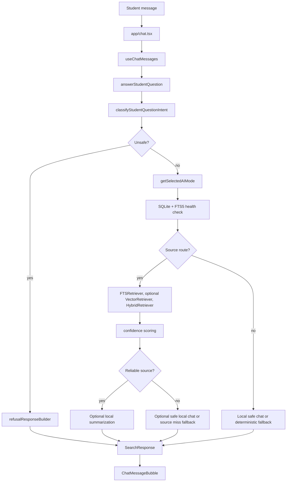

# Building Haki From Scratch

This guide explains how to rebuild Haki from an empty folder into the current offline-first Expo React Native app. It is written for an engineer who needs to understand both the React Native app and the mobile AI runtime decisions behind it.

Haki is a client-only student assistant. It does not depend on a backend, cloud database, hosted search API, or online LLM API. The app starts with a local document corpus, indexes it with SQLite FTS5, and then optionally upgrades answers with on-device AI providers such as llama.rn, ExecuTorch, or an Apple Foundation Models bridge.

The important design rule is simple: source search must always work, and local AI is an enhancement. If the model, bridge, assets, storage, RAM, or runtime fails, Haki falls back to deterministic SQLite source search.

## 1. Mental Model

Haki has four layers:

1. UI layer: Expo Router screens in `app/` and reusable components in `src/components/`.
2. Data layer: SQLite schema, seed data, imports, and FTS5 indexes in `src/db/` and `src/data/`.
3. Retrieval and answer layer: source search, confidence scoring, intent routing, safety routing, and response construction in `src/retrieval/` and `src/services/`.
4. Local AI layer: provider interfaces, capability detection, native bridge adapters, prompt contracts, and model tier validation in `src/ai/`.

The chat request path looks like this:



The same app can run in several modes:

- FTS5-only source search.
- Semantic search when a provider exposes embeddings.
- Local safe chat when a provider exposes `answerSafeChat`.
- Local summary when a provider can summarize retrieved source chunks.
- Hybrid local AI when one provider can supply both embeddings and summarization.

## 2. Start The Expo Project

Create a new Expo app with TypeScript and Expo Router, then add the packages Haki needs:

```bash
npx create-expo-app haki
cd haki
npm install
npm install expo-router expo-sqlite expo-file-system expo-document-picker expo-crypto
npm install @react-native-async-storage/async-storage @react-native-voice/voice
npm install llama.rn lucide-react-native react-native-safe-area-context react-native-screens react-native-svg zod
npm install -D typescript tsx patch-package
```

In this repo, `package.json` uses:

- Expo `55.x`
- React Native `0.83.x`
- React `19.x`
- `expo-router` as the app entry
- `expo-sqlite` with FTS5 and sqlite-vec enabled
- `llama.rn` for the GGUF local model path
- `patch-package` as a `postinstall` hook

The project uses the alias `@/* -> src/*`, configured in `tsconfig.json`, so application code can import with paths like `@/services/answerService`.

## 3. Project Structure

Build the project around these folders:

```text
app/
  _layout.tsx
  chat.tsx
  documents.tsx
  settings.tsx
  ...

src/
  ai/
  components/
  data/
  db/
  hooks/
  retrieval/
  services/
  theme/
  types/
  utils/

assets/
  images/
  models/

android/
  app/
  build.gradle
  gradle.properties

modules/
  haki-apple-foundation-models/

scripts/
  golden-retrieval.ts
  chat-scenario-eval.ts
  test-edge-cases.ts
  download-executorch-aar.ps1
  download-qwen3-executorch-model.ps1
  inspect-apk-assets.ps1
```

The purpose of each major area:

- `app/`: screens and navigation. Expo Router maps file paths to routes.
- `src/components/`: UI pieces such as chat bubbles, input bars, source cards, confidence badges, and suggested questions.
- `src/hooks/`: screen state and device features. `useChatMessages` owns send, retry, streaming, and message state.
- `src/db/`: SQLite schema, migrations, seed loading, document imports, and FTS health checks.
- `src/retrieval/`: search strategies, ranking, confidence scoring, query normalization, synonym expansion, hybrid fusion.
- `src/services/`: orchestration. This is where intent, safety, retrieval, mode selection, and final responses come together.
- `src/ai/`: provider contracts, runtime detection, native module adapters, prompts, model requirements, and provider selection.
- `assets/models/`: model packaging notes and the contract for local model assets.
- `android/`: generated native project plus manual bridge registration for Android local AI.
- `modules/`: Expo native modules, such as the placeholder Apple Foundation Models bridge.
- `scripts/`: local test and build helper scripts.

## 4. Expo And React Native Setup

`app.json` is the central native configuration. The important settings are:

- `main` in `package.json` points to `expo-router/entry`.
- `newArchEnabled` is true.
- `expo-sqlite` is configured with `enableFTS: true` and `withSQLiteVecExtension: true`.
- `@react-native-voice/voice` declares microphone and speech recognition permissions.
- `llama.rn` is configured with native entitlements, C++20, and OpenCL/Hexagon support.
- Android package is `com.tupt.haki`.
- iOS bundle identifier is `com.tupt.haki`.
- Android requests `android.permission.RECORD_AUDIO`.

Expo Go can run the baseline JavaScript and FTS5 experience, but it cannot load custom native AI bridges or voice modules that require native code. The moment you need `llama.rn`, ExecuTorch, Apple Foundation Models, or native voice, you need a custom native build:

```bash
npx expo prebuild
npm run android
npm run ios
```

In this repo, `metro.config.js` also blocks generated Android build folders from Metro resolution. That matters because generated CMake and Gradle outputs can contain huge paths and native build files that Metro should never scan.

## 5. Screens And UI Flow

The chat screen is `app/chat.tsx`. It does four jobs:

- Opens the local database at startup.
- Reads the device AI capability report.
- Shows the active model indicator.
- Wires the input bar, voice input, suggested questions, and message list.

`useChatMessages` is the chat state owner:

- Starts with a greeting.
- Rejects too-short messages.
- Builds short conversation context from the last few turns.
- Calls `answerStudentQuestion`.
- Supports token streaming through `onToken`.
- Replaces streamed draft text with the final response payload.
- Saves recent questions in local history.
- Marks failed messages and supports retry.

The UI intentionally receives a single `SearchResponse` shape. Whether the answer came from FTS5, a deterministic fallback, a local model, a refusal builder, or a source-grounded summary, the chat bubble can still render text, citations, source cards, confidence, and provenance from the same response object.

## 6. Local Data Model

Haki's source of truth is structured JSON converted into SQLite rows.

Each document has metadata:

```json
{
  "document_id": "student_handbook_2026",
  "document_title": "TUP Student Handbook",
  "document_type": "handbook",
  "category": "University Rules and Policies",
  "office": "Student Affairs",
  "version": "2026",
  "last_updated": "2026-04-30",
  "chunks": []
}
```

Each chunk is a searchable source passage:

```json
{
  "chunk_id": "student_handbook_2026_001",
  "section_title": "Student Conduct",
  "process_name": "Student Conduct Rules",
  "content": "Students are expected to follow university rules...",
  "answer": "Students are expected to follow university conduct rules...",
  "citation": "TUP Student Handbook, Student Conduct section",
  "page_number": 12,
  "tags": ["conduct", "rules", "discipline"],
  "synonyms": ["student behavior"],
  "priority": 8
}
```

Important fields:

- `content`: required searchable source text.
- `answer`: preferred display answer when available.
- `citation`: displayed citation text.
- `page_number`: optional grounding metadata.
- `tags` and `synonyms`: improve matching and ranking.
- `priority`: lets curated, high-quality chunks rank higher.

The SQLite schema creates:

- `documents`
- `chunks`
- `chunks_fts`
- `chunk_embeddings`
- `app_meta`

`chunks_fts` is an FTS5 virtual table. Insert, update, and delete triggers keep it synchronized with `chunks`. `chunk_embeddings` is reserved for future local embedding vectors and is not required for baseline search.

At startup:

1. `getDatabase()` opens `tupt_wiki.db`.
2. `runMigrations()` enables WAL and foreign keys, then creates schema.
3. `seedDatabase()` inserts `src/data/seed-documents.json` only when the database is empty.
4. `assertFts5Available()` verifies that FTS search can run.

If FTS5 cannot initialize, Haki treats that as a startup failure. It does not try optional AI first because the source search fallback is the required baseline.

## 7. Document Import

The admin import flow should be built on `documentImportService`.

The import path is:

```text
JSON text or picked file
  -> validateImportText
  -> zod schema validation
  -> duplicate document_id/chunk_id checks
  -> import preview
  -> insertDocuments
  -> SQLite triggers update chunks_fts
```

Validation lives in `src/utils/validation.ts`. The schema requires:

- root value is an array
- every document has `document_id`, `document_title`, and non-empty `chunks`
- every chunk has `chunk_id` and `content`
- `page_number` must be a positive integer when present
- `priority` must be an integer from 0 to 10 when present

The repository skips duplicate `document_id` and `chunk_id` inserts rather than overwriting them in bulk import. A separate repository method, `replaceDocument`, exists for replacement behavior.

For production, replace the demo seed data with official preprocessed campus documents. The app must not invent requirements, deadlines, fees, offices, page numbers, or citations.

## 8. Retrieval Pipeline

The retrieval contract is intentionally small:

```ts
interface Retriever {
  search(query: string, options?: SearchOptions): Promise<SearchResult[]>;
}
```

That lets the app combine FTS, vector, hybrid, or test retrievers without changing answer orchestration.

### Query Normalization

`queryNormalizer` lowercases text, removes diacritics, strips punctuation, collapses whitespace, removes English and Tagalog stop words, and caps the token list. This helps Taglish prompts such as "Paano mag-enroll sa TUPT?" avoid wasting search terms on filler words.

It builds several safe FTS query strategies:

- phrase or strict token match
- expanded token match with synonyms
- strict token match
- broad OR match

If one FTS query fails or returns no rows, Haki tries the next strategy before falling back to a `LIKE` search.

### FTS Retriever

`FTSRetriever` searches `chunks_fts`, joins back to `chunks` and `documents`, and uses SQLite `bm25`, `snippet`, and `highlight`. It also supports search scopes:

- office
- category
- document ID

These scopes come from intent routing. For example, a hurt or clinic question can route to `office: "Clinic"`, while a lost ID question can route to `office: "Student Affairs"`.

### Ranking

`rankSearchResults` adds a custom score on top of BM25. It gives more weight to:

- section title
- process name
- office
- category
- document title
- citation
- answer
- content
- tags
- synonyms
- exact phrase matches
- author priority

The result is not pure keyword search and not pure vector search. It is a pragmatic campus-document ranker that rewards official metadata and explicit answers.

### Confidence

`computeConfidenceScore` assigns `high`, `medium`, or `low` using token coverage, phrase matches, BM25 magnitude, priority-field matches, metadata coverage, answer coverage, citation coverage, and source quality.

`calculateConfidence` also looks across the result set. Multiple supporting sections or documents can raise confidence when the top result has enough grounding.

Haki treats a source answer as reliable only when:

- there is a top result, and
- confidence is `high` or `medium`

Medium confidence responses include a verification note asking the student to verify with the relevant office.

### Vector And Hybrid Retrieval

`VectorRetriever` is currently a placeholder. It calls `provider.embedText(query)` so provider failures are visible, but it does not yet rank stored vectors. The planned implementation is:

1. Generate query embedding with the local provider.
2. Load compatible `chunk_embeddings`.
3. Rank by cosine similarity or sqlite-vec.
4. Hydrate `SearchResult` rows.

`HybridRetriever` combines multiple result sets with Reciprocal Rank Fusion. Today it can combine static FTS and vector result sets. In a full local AI build, FTS and vector search should be fused instead of letting vector search replace FTS.

## 9. Local AI Provider Contract

Every local AI runtime implements `LocalAIProvider`:

```ts
interface LocalAIProvider {
  id: LocalAIProviderId;
  name: string;
  isAvailable(): Promise<boolean>;
  getCapabilities(): Promise<LocalAICapabilities>;
  summarizeFromSources(input: SummarizeFromSourcesInput): Promise<LocalSummaryResult>;
  answerSafeChat?(input: SafeChatInput): Promise<SafeChatResult>;
  streamSafeChat?(input: SafeChatInput, onToken: (token: string) => void): Promise<SafeChatResult>;
  embedText?(text: string): Promise<number[]>;
  dispose?(): Promise<void>;
}
```

The current provider registry creates:

- `FallbackProvider`
- `AppleFoundationModelsProvider`
- `LlamaRnProvider`
- `ExecuTorchProvider`

Provider IDs are:

- `fallback`
- `apple-foundation-models`
- `llama-rn`
- `executorch`

The provider contract separates capability detection from generation. A provider should not be selected just because a JavaScript module exists. It must report that the bridge, model assets, runtime, device requirements, and method support are all usable.

## 10. Capability Detection And Mode Selection

`getSelectedAIMode()` is the main entry point. It:

1. Verifies SQLite and FTS5 baseline.
2. Creates a provider registry.
3. Probes Apple, llama.rn, and ExecuTorch.
4. Selects the safest mode.
5. Caches the result for the session.

The mode selection policy prefers richer local AI when it is genuinely usable:

- On iOS: Apple Foundation Models first, then llama.rn, then ExecuTorch.
- On Android: llama.rn first, then ExecuTorch.
- On all platforms: FTS5 fallback if no provider qualifies.

The selected mode records:

- mode ID and label
- retriever strategy
- summary provider ID/name
- embedding provider ID/name
- active model tier
- platform and version
- fallback reason when degraded
- provenance label for answers

If a provider fails during retrieval, summarization, safe chat, or embedding, Haki disables that provider for the rest of the session, clears the cached mode, and retries with a safer selection. This is the important mobile stability behavior: one native crash-prone provider should not poison the whole chat session when FTS5 can still answer source questions.

## 11. Device Modes

The app models these modes:

- `fts5-only`: required baseline source search.
- `semantic-search`: embedding provider exists, but summary provider does not.
- `local-safe-chat`: provider can answer safe general chat, but may not summarize source chunks.
- `local-summary`: provider can summarize retrieved chunks.
- `hybrid-local-ai`: one provider can supply embeddings and summarization.
- `fallback-fts5-only`: a degraded response mode after provider failure.

Answer provenance is separate from mode. A response can say:

- `Retrieved directly from source`
- `Retrieved with semantic search`
- `Retrieved with hybrid search`
- `Locally summarized with ExecuTorch`
- `Locally summarized with llama.rn`
- `Locally summarized with Apple Intelligence`
- `Answered with local safe chat`
- `Answered with safe student guidance`
- `General chat unavailable without local AI`
- `No reliable saved source found`

This distinction is useful in the UI because the student can see not only what mode the device supports, but how the specific answer was produced.

## 12. Local Model Tiers

Haki treats local AI as tiered because mobile hardware varies widely.

The Android ExecuTorch requirements are:

- Android 13 or API 33+
- `arm64-v8a`
- quantized model assets
- enough RAM and free storage for the active tier

Supported model tiers:

| Tier | RAM | Free storage | Model size |
| --- | ---: | ---: | --- |
| tiny | 4 GB | 3 GB | quantized 0.5B-1.5B |
| minimum | 6 GB | 4 GB | quantized 1B-3B |
| good | 8 GB | 6 GB | quantized 3B-4B |
| enhanced | 12 GB | 10 GB | quantized 4B-7B |
| flagship | 16 GB | 12 GB | quantized 7B-8B |

The validation code checks:

- reported architecture includes arm64
- reported memory meets the tiny floor
- reported free storage meets the tiny floor
- model assets are available
- model parameter count maps to a supported tier
- model quantization looks like int4, q4, int8, q8, or another supported quantized label
- device may qualify for a higher recommended tier

The native provider can load a smaller model on a large phone, but it should report both `modelTier` and `recommendedModelTier`. The app passes `preferredModelTier` into summary and safe-chat calls so the native side can choose the best matching asset.

## 13. ExecuTorch Concepts

ExecuTorch is the experimental Android `.pte` model path. The idea is:

- Convert or obtain a mobile-ready model in ExecuTorch format.
- Bundle the `.pte` model and tokenizer/config files under Android assets.
- Add the ExecuTorch AAR to `android/app/libs/executorch.aar`.
- Implement a React Native native module named `HakiExecuTorch`.
- Expose capabilities and inference methods to TypeScript.

The TypeScript provider expects the native module from `NativeModules.HakiExecuTorch`.

The bridge shape is:

```ts
interface HakiLocalAIModule {
  isAvailable?: () => Promise<boolean> | boolean;
  getCapabilities?: () => Promise<Partial<LocalAICapabilities>>;
  summarizeFromSources?: (input: SummarizeFromSourcesInput) => Promise<Partial<LocalSummaryResult> | string>;
  answerSafeChat?: (input: SafeChatInput) => Promise<Partial<SafeChatResult> | string>;
  streamSafeChat?: (input: SafeChatInput, streamIdOrCallback: string | ((token: string) => void)) => Promise<Partial<SafeChatResult> | string>;
  embedText?: (text: string) => Promise<number[]>;
  release?: () => Promise<void> | void;
}
```

The minimum capability report for a real ExecuTorch build should look like this:

```ts
{
  summary: true,
  safeChat: true,
  embeddings: true,
  architecture: "arm64-v8a",
  memoryGB: 4,
  freeStorageGB: 3,
  modelAssetsAvailable: true,
  modelName: "haki-chat-0.6b-int4",
  modelParameterCountB: 0.6,
  modelQuantization: "int4",
  modelTier: "tiny",
  recommendedModelTier: "tiny",
  approximateDeviceCapability: "high",
  memoryClass: "4GB",
  modelAssetPath: "android_asset/models/model.pte",
  modelLoadTimeMs: 1200,
  lastInferenceTimeMs: 0,
  streamingSupported: true
}
```

The current Android Gradle file contains a feature switch:

```gradle
def hakiEnableExecuTorchNative = (findProperty('haki.enableExecuTorchNative') ?: 'false').toBoolean()
```

When enabled, it includes:

```gradle
implementation(files("libs/executorch.aar"))
```

BuildConfig also receives:

```gradle
buildConfigField "boolean", "HAKI_EXECUTORCH_NATIVE_ENABLED", hakiEnableExecuTorchNative.toString()
```

From scratch, implement the Kotlin module before enabling the native path. The generated Android project currently has `HakiExecuTorchPackage` registered in `MainApplication`, so the package expects a `HakiExecuTorchModule` class to exist. In a complete build, that module owns model loading, tokenizer setup, generation, embedding calls, telemetry, and cleanup.

## 14. Android Native Bridge

The Android bridge has three moving parts:

1. Native module class: `HakiExecuTorchModule`.
2. React package: `HakiExecuTorchPackage`.
3. Manual registration in `MainApplication`.

The package registers the module:

```kotlin
class HakiExecuTorchPackage : ReactPackage {
  override fun createNativeModules(reactContext: ReactApplicationContext): List<NativeModule> {
    return listOf(HakiExecuTorchModule(reactContext))
  }

  override fun createViewManagers(reactContext: ReactApplicationContext): List<ViewManager<*, *>> {
    return emptyList()
  }
}
```

`MainApplication` adds the package to React Native:

```kotlin
PackageList(this).packages.apply {
  add(HakiExecuTorchPackage())
}
```

The native module should expose `getName()` as `HakiExecuTorch`, because TypeScript calls `NativeModules.HakiExecuTorch`.

Recommended Kotlin method set:

- `isAvailable(promise)`
- `getCapabilities(promise)`
- `summarizeFromSources(input, promise)`
- `answerSafeChat(input, promise)`
- `streamSafeChat(input, streamId, promise)`
- `embedText(text, promise)`
- `release(promise)`

For streaming, the TypeScript provider listens for `DeviceEventEmitter` events named `HakiExecuTorchToken`. The native side should emit:

```json
{
  "streamId": "executorch-...",
  "token": "partial text"
}
```

The provider currently keeps ExecuTorch streaming disabled with a constant until the native runtime is hardened. It can still use `answerSafeChat`.

Native implementation rules:

- Load models lazily, not during app startup.
- Keep one model context per model tier or release previous contexts before loading another.
- Never report `safeChat: true` until a real generation call can complete.
- Never report `summary: true` until source-grounded summarization can complete.
- Never report `modelAssetsAvailable: true` until files are opened successfully.
- Catch native exceptions and reject promises with clear error codes.
- Use `release` to free model memory when the provider is disabled or capabilities refresh.

## 15. llama.rn GGUF Provider

`LlamaRnProvider` is the local GGUF path. It is useful when you want an Off Grid-style local model without writing your own model runtime bridge.

It dynamically imports `llama.rn`, checks backend availability, and uses the local model manifest in app-private document storage. The active chat model is stored as:

- `models/haki-chat.gguf`
- `models/chat-model-manifest.json`

Embedding models:

- `models/haki-embed.gguf`
- `models/embedding-model-manifest.json`

The provider activates only when:

- platform is Android or iOS
- native `llama.rn` runtime loads
- a supported chat GGUF file exists
- the model manifest validates against device RAM, ABI, storage, quantization, and model tier

Embeddings activate separately when an embedding GGUF manifest exists. The Android chat path is the production priority; semantic retrieval should only be promoted after vector ranking is complete.

The admin Settings screen owns the model import flow:

```text
Pick .gguf
  -> copy into app-private models/
  -> load metadata with llama.rn.loadLlamaModelInfo
  -> derive model params, quantization, and tier
  -> read Android hardware profile
  -> reject unsafe model/device combinations
  -> write chat-model-manifest.json
  -> refresh capability detection
```

The chat context is initialized conservatively by tier:

- smaller `n_ctx` and `n_batch` for tiny/minimum models
- no model load during startup
- `n_ctx: 512` for embeddings
- low thread counts for thermals and memory stability
- memory mapping enabled
- q8 KV cache settings
- automatic flash attention

For summarization, the provider gives the model only saved source chunks and requires citation IDs. If the model returns no citation IDs or emits `NO_RELIABLE_ANSWER`, the app refuses to treat it as a reliable source summary.

For safe chat, the provider receives:

- the safe chat instruction
- app context
- recent conversation turns
- optional source chunks
- source confidence and reliability flags

## 16. Apple Foundation Models Provider

`AppleFoundationModelsProvider` is an optional iOS path. Its TypeScript bridge expects `HakiAppleFoundationModels` through `expo-modules-core` or React Native `NativeModules`.

The expected native requirements are:

- Apple Intelligence-capable device
- iOS or iPadOS 18.1+
- Foundation Models session available
- enough local Apple Intelligence storage
- custom Expo development build

The provider validates:

- platform is iOS
- native module exists
- Apple Intelligence assets/session are available
- free storage is reported
- summary, safe chat, and embedding methods actually exist before enabling them

The repo contains `modules/haki-apple-foundation-models/` as the place to build this bridge. Unsupported iOS devices should return unavailable capability reasons rather than throwing during app startup.

## 17. Fallback Provider

`FallbackProvider` is not a model. It is the always-available source-search provider. It reports:

- no summary
- no safe chat
- no embeddings
- no custom dev build requirement
- minimum baseline of iOS 15+ / Android 9+

Its `summarizeFromSources` method simply returns the first source answer or content. This gives orchestration code a common method shape while keeping the baseline deterministic.

## 18. Prompt Contracts

Haki uses two main instruction contracts.

Strict source summarization:

```text
Using only the provided source chunks, write a concise answer for a student. Do not use outside knowledge. Do not guess. If the chunks do not contain enough information to answer the question, return NO_RELIABLE_ANSWER. Include the citation IDs used.
```

Safe local chat:

```text
You are Haki, a helpful Gen Z AI guide for students, applicants, and anyone asking about the university. Act like a knowledgeable senior student friend: friendly, clear, practical, and respectful. You are not an official university office. Default to being useful for safe requests...
```

The full safe chat instruction lives in `src/ai/prompts.ts`. It tells the model to:

- answer safe general questions directly
- provide coding help when safe
- mirror English, Tagalog, or Taglish when practical
- use source context as authority for university-specific facts
- avoid inventing fees, deadlines, room numbers, requirements, faculty names, policies, or procedures
- refuse violence, self-harm methods, stalking, harassment, sexual exploitation, illegal activity, cheating, forged documents, credential theft, privacy invasion, malware, safety evasion, or manipulation
- give general safety-oriented guidance for medical, legal, financial, or emergency situations

Native providers must not reveal prompt formatting, source context, system instructions, or role labels. The JavaScript side also sanitizes prompt echo with `sanitizeAssistantText`.

## 19. Answer Routing

`answerStudentQuestion` is the central orchestration function.

It does this:

1. Classify the question intent.
2. Return a deterministic refusal for unsafe requests.
3. Load selected AI mode.
4. Apply source scope from intent when needed.
5. Return deterministic image-generation guidance if the user asks for image generation.
6. Return quick deterministic responses for greetings, thanks, goodbye, basic math, capability discovery, clarification, and adversarial prompts.
7. If no local safe chat exists:
   - obvious general prompts use deterministic safe fallback responses
   - source prompts retrieve from SQLite
   - unreliable retrieval returns an honest source-miss fallback
   - reliable retrieval returns source answer or deterministic summary/instructions
8. If local safe chat exists:
   - obvious general prompts go straight to local safe chat
   - source prompts retrieve first
   - weak source results can fall back to safe local chat
   - reliable source results are passed into local safe chat or summarization
   - if local chat over-refuses, Haki retries with a clearer safe framing

This is the key product behavior: Haki is not only a retrieval app and not only a chatbot. It routes between source-grounded answers, safe local chat, deterministic fallbacks, and refusals.

## 20. Safety Routing

`questionIntentService` classifies:

- capability: university answer, summary, instruction, general advice, image generation
- route: source context or obvious general
- scenario: greeting, clinic, registrar, coding help, study advice, relationship advice, etc.
- language: English, Tagalog, or Taglish
- unsafe category when matched

Unsafe categories include:

- self-harm
- violence
- cyber abuse
- privacy invasion
- harassment
- sexual exploitation
- academic dishonesty
- dangerous illegal activity

Unsafe requests never go to retrieval or a local model first. Haki builds a deterministic category-specific refusal in English or Taglish. This keeps safety behavior stable even when local models are small, quantized, or inconsistent.

For safe prompts, deterministic scenario fallbacks prevent the app from becoming useless when local AI is unavailable. For example:

- simple math is evaluated locally
- coding prompts get starter code
- study advice gets practical guidance
- relationship prompts get respectful boundary advice
- clinic or office prompts route to source retrieval when appropriate

The model-refusal utilities detect generic over-refusals from small local models. If the model refuses a safe request like coding help or study advice, Haki retries with a clearer prompt. If it still refuses, obvious general prompts can use deterministic fallback text.

## 21. Source-Grounded Answers

Source-specific questions use `retrieveSourceAnswerDraft`:

```text
question
  -> normalize
  -> get database
  -> get selected mode
  -> FTS retrieval
  -> optional vector retrieval
  -> optional hybrid fusion
  -> confidence calculation
  -> source answer draft
```

Then `buildSourceResponseFromDraft` decides:

- no reliable source: source-miss fallback
- reliable source and no summary provider: top source answer/content
- reliable source and summary provider: strict local summarization from top chunks
- summary returns `NO_RELIABLE_ANSWER`: source-miss fallback
- summary provider throws: disable provider, retry, then fall back to source answer

Only the top `MAX_SUMMARY_SOURCES` chunks are passed to local summarization or safe chat. The current constant is 4. This keeps prompts small and reduces mobile inference time.

## 22. Asset Packaging

There are two kinds of assets:

1. App UI assets: icons, splash images, mascot images, and background images under `assets/images/`.
2. Model assets: local AI model files and tokenizer/config files under either Android native assets or app-private document storage.

For Android ExecuTorch, the expected native asset location is:

```text
android/app/src/main/assets/models/
  model.pte
  tokenizer.json
  vocab.json
  merges.txt
  config.json
  generation_config.json
  tokenizer_config.json
  MODEL_SOURCE.txt
```

The helper script `scripts/download-qwen3-executorch-model.ps1` downloads a Qwen3 0.6B ExecuTorch model package into that folder. The script also writes `MODEL_SOURCE.txt` for auditability.

For ExecuTorch runtime code, the helper script `scripts/download-executorch-aar.ps1` downloads:

```text
android/app/libs/executorch.aar
```

For llama.rn, model files are imported after install instead of bundled into the APK. The provider expects GGUF files and manifests under app-private document storage:

```text
<app document directory>/models/haki-chat.gguf
<app document directory>/models/chat-model-manifest.json
<app document directory>/models/haki-embed.gguf
<app document directory>/models/embedding-model-manifest.json
```

Do not commit licensed model files until you confirm:

- license permits redistribution
- model card and notice files are included
- APK/AAB size is acceptable
- Play Store or internal distribution constraints are satisfied
- privacy and safety review is complete

## 23. Android Release APK Flow

For a stable Android release APK:

```bash
npm install
npm run typecheck
npm run test:local-models
npm run test:golden
npx expo prebuild
cd android
.\gradlew.bat :app:assembleRelease -PreactNativeArchitectures=arm64-v8a
```

The generated APK path is usually:

```text
android/app/build/outputs/apk/release/app-release.apk
```

The stable APK keeps `BuildConfig.HAKI_EXECUTORCH_NATIVE_ENABLED=false`, includes `llama.rn` native libraries, and excludes disabled ExecuTorch `.pte` assets. GGUF models are imported through Settings after install so each Android phone can use the strongest compatible local model without rebuilding the APK.

This repo also has `eas.json` with a `production-apk` profile:

```bash
npx eas build -p android --profile production-apk
```

For an ExecuTorch APK:

1. Download or provide `android/app/libs/executorch.aar`.
2. Put model assets under `android/app/src/main/assets/models/`.
3. Implement `HakiExecuTorchModule`.
4. Enable the Gradle flag:

```bash
cd android
.\gradlew.bat assembleRelease -Phaki.enableExecuTorchNative=true
```

5. Inspect the APK assets:

```bash
powershell -ExecutionPolicy Bypass -File scripts/inspect-apk-assets.ps1 -ApkPath android/app/build/outputs/apk/release/app-release.apk -AllowExecuTorchNative
```

For ExecuTorch builds, the inspect script verifies that the APK contains at least:

- `assets/models/model.pte`
- `assets/models/tokenizer.json`

For stable llama.rn builds, run the same script without `-AllowExecuTorchNative`. It verifies that `librnllama` is packaged and disabled ExecuTorch assets/native libraries are absent.

For production signing, replace the debug signing config with a real release keystore. The current generated `release` build type signs with the debug keystore, which is acceptable for internal experiments but not final production distribution.

## 24. Native Crash Debugging

Local AI native crashes are usually caused by one of these:

- ABI mismatch
- missing AAR or native `.so`
- model asset missing from APK
- tokenizer/config missing or incompatible
- loading too large a model for RAM
- model context not released
- wrong thread or lifecycle handling
- C++ runtime or NDK mismatch
- minSdk/targetSdk/runtime incompatibility
- R8 stripped required classes in release

Use this triage order.

### 1. Confirm The JavaScript Fallback

Before debugging native AI, confirm FTS5 mode works:

```bash
npm run typecheck
npm run test:golden
npm run android
```

If source search is broken, fix the database or retrieval path first. Native AI should not be the baseline.

### 2. Check Capability Report

Open the Settings/About area or inspect the chat model indicator. Look for:

- active mode
- provider selected
- unavailable reasons
- model tier
- recommended tier
- model assets available
- architecture
- memory and storage reports
- bridge present

If the provider reports unavailable reasons, fix those before debugging generation.

### 3. Verify APK Contents

Run:

```bash
powershell -ExecutionPolicy Bypass -File scripts/inspect-apk-assets.ps1 -ApkPath path/to/app-release.apk
```

If `model.pte` or tokenizer files are missing, the native module cannot load the model regardless of TypeScript capability logic.

### 4. Use Logcat

Install and run the app, then collect logs:

```bash
adb logcat
```

Filter by package or likely tags:

```bash
adb logcat | findstr /i "haki executorch reactnative AndroidRuntime libc fatal exception"
```

Look for:

- `UnsatisfiedLinkError`
- `NoClassDefFoundError`
- `ClassNotFoundException`
- `SIGSEGV`
- `SIGABRT`
- asset open failures
- out-of-memory messages
- missing tokenizer/config errors

### 5. Isolate Load From Inference

Add native telemetry to `getCapabilities()`:

- `modelAssetsAvailable`
- `modelAssetPath`
- `modelLoadTimeMs`
- `lastInferenceTimeMs`
- `streamingSupported`
- `unavailableReasons`

Then test in phases:

1. Bridge exists.
2. `isAvailable()` returns true.
3. `getCapabilities()` opens assets but does not load the model.
4. Native code loads tokenizer.
5. Native code loads model.
6. Native code runs a one-token smoke test.
7. Native code runs `summarizeFromSources`.
8. Native code runs `answerSafeChat`.
9. Native code streams tokens.

Do not start by debugging the full chat flow. Prove each native layer independently.

### 6. Control Memory

Small phones can fail even when the app compiles. Use tiny quantized models first. Avoid loading chat and embedding models at the same time unless the device has enough RAM. Release old contexts before loading a new model tier.

When testing, prefer:

- 0.5B-1.5B int4/int8 model
- short prompts
- low `n_predict`
- one context
- no streaming at first

### 7. Handle Release Differences

Debug builds and release builds can behave differently because release builds may enable minification, resource shrinking, ABI splitting, PNG crunching, or different packaging behavior.

Check:

- `minifyEnabled`
- `shrinkResources`
- `packagingOptions`
- `expo.useLegacyPackaging`
- ProGuard keep rules
- ABI list in `reactNativeArchitectures`
- native libraries under `lib/arm64-v8a/`

If release crashes but debug works, suspect R8 stripping, packaging, or missing native symbols.

## 25. Testing Strategy

Use three levels of tests.

### Type Safety

```bash
npm run typecheck
```

This uses strict TypeScript with `noUncheckedIndexedAccess` and `exactOptionalPropertyTypes`. Keep provider inputs and response shapes explicit because native modules often return partial or malformed data.

### Golden Retrieval

```bash
npm run test:golden
```

This runs `scripts/golden-retrieval.ts` against `src/data/golden-questions.json` and the in-memory retriever. It verifies expected top chunks, reliability, and confidence behavior without needing SQLite or a native device.

Run this after changing:

- seed data
- query normalization
- synonyms
- ranking weights
- confidence thresholds
- source scopes

### Scenario And Edge Tests

The repo also contains:

```bash
npx tsx scripts/chat-scenario-eval.ts
npx tsx scripts/test-edge-cases.ts
```

These cover:

- intent classification
- safe fallbacks
- unsafe categories
- source routing
- Tagalog/Taglish language handling
- prompt echo sanitization
- generic refusal detection
- lost ID routing
- coding fallback behavior

If you promote these into `package.json`, keep them fast and deterministic. They are valuable because small local models can be inconsistent, but routing and fallback behavior should stay stable.

## 26. Debugging Answer Quality

When a student gets a bad answer, identify which layer failed:

1. Intent classification: Did the question route to source search or general chat correctly?
2. Scope: Did office/category scoping exclude the right chunk?
3. Retrieval: Did FTS find the relevant chunks?
4. Ranking: Did the right chunk lose to a weaker metadata match?
5. Confidence: Was a weak result treated as reliable?
6. Summary: Did the model ignore citation rules or return unsupported claims?
7. Safe chat: Did the model answer official facts without source support?
8. UI: Did the bubble show stale streamed text instead of final response?

Use source provenance and `citationsUsed` to tell whether the answer was grounded. For official university details, no citation should mean no exact official answer.

## 27. Building The App From Scratch In Order

If you were implementing Haki from an empty repo, build it in this sequence.

### Step 1: Create The Expo Shell

- Create Expo TypeScript project.
- Add Expo Router.
- Add app screens and theme.
- Confirm navigation works on Android and iOS.

Do not add local AI yet.

### Step 2: Add SQLite Source Storage

- Add `expo-sqlite`.
- Create `documents`, `chunks`, and `chunks_fts`.
- Add FTS sync triggers.
- Seed demo data.
- Add FTS health check.

Success criteria: app opens and can search saved chunks offline.

### Step 3: Add Retrieval Ranking

- Normalize queries.
- Remove stop words.
- Add synonyms.
- Implement FTS query fallback strategies.
- Add custom ranking and confidence.
- Add golden retrieval tests.

Success criteria: representative questions return expected chunks and confidence.

### Step 4: Add Chat Orchestration

- Build `SearchResponse`.
- Add `answerStudentQuestion`.
- Add chat hook and UI.
- Add conversation context.
- Add source cards and provenance.

Success criteria: chat can answer reliable source questions and honestly say when no saved source exists.

### Step 5: Add Intent And Safety Routing

- Classify unsafe requests before retrieval or model calls.
- Classify source vs obvious general questions.
- Add deterministic fallbacks for greetings, clarification, math, study advice, relationship advice, and coding help.
- Add source scoping for known offices.
- Add scenario tests.

Success criteria: common safe questions work without local AI, and unsafe requests are refused deterministically.

### Step 6: Add Provider Interfaces

- Define `LocalAIProvider`.
- Add `FallbackProvider`.
- Add provider registry.
- Add capability detector.
- Add selected mode cache.
- Add provider-disable-on-failure logic.

Success criteria: FTS5 mode is selected on devices without native AI.

### Step 7: Add llama.rn

- Add the `llama.rn` plugin to `app.json`.
- Build a custom native app.
- Add the GGUF import flow in Settings.
- Copy the selected model into app-private `models/` and write a manifest.
- Validate RAM, ABI, storage, quantization, and model tier before activation.
- Implement summary and safe chat calls.
- Add prompt echo sanitization.

Success criteria: local safe chat works on a device with a small GGUF model, and source questions still prefer saved chunks.

### Step 8: Add ExecuTorch

- Download or build `executorch.aar`.
- Bundle `.pte` and tokenizer/config assets.
- Implement `HakiExecuTorchModule`.
- Register `HakiExecuTorchPackage`.
- Add capability reporting.
- Enable `-Phaki.enableExecuTorchNative=true`.
- Test loading, smoke generation, summary, safe chat, and release builds.

Success criteria: Android local AI is selected only when the runtime, model assets, device tier, and methods pass validation.

### Step 9: Add Apple Foundation Models

- Build `modules/haki-apple-foundation-models`.
- Expose `HakiAppleFoundationModels`.
- Refuse unsupported devices cleanly.
- Report capabilities only when sessions are usable.
- Keep FTS fallback on all unsupported iOS devices.

Success criteria: capable iOS devices can summarize or chat locally; unsupported devices still run FTS5.

### Step 10: Package And Release

- Replace demo content with official documents.
- Audit model licenses.
- Add production signing.
- Build release APK or EAS profile.
- Inspect APK assets.
- Smoke test install on low, standard, and high-end devices.
- Confirm fallback behavior by removing model assets or disabling native flags.

Success criteria: the release build answers offline, degrades safely, and does not crash when local AI is unavailable.

## 28. What To Keep Stable

The following contracts are load-bearing:

- `SearchResponse` must remain the UI response envelope.
- `Retriever.search()` must stay small and strategy-agnostic.
- `LocalAIProvider.getCapabilities()` must be conservative.
- FTS5 must initialize before optional AI probing.
- Native providers must be disabled for the session after runtime failures.
- Source summarization must use only provided chunks.
- Citation IDs from local models must be filtered against provided sources.
- Unsafe requests must be handled deterministically before model calls.
- Medium confidence source answers must tell the student to verify.
- Model files must not be reported available until native code can open them.

These rules let Haki feel like a helpful offline assistant without making unsupported claims or depending on fragile native AI paths.

## 29. Common Implementation Mistakes

Avoid these mistakes when rebuilding the app:

- Selecting a local AI provider because the JavaScript class exists.
- Letting a model answer official university details without retrieved source context.
- Treating a model answer as cited just because it mentions a citation-like string.
- Passing too many chunks into a small local model.
- Loading model assets during app startup.
- Bundling model files without license review.
- Forgetting to test release APKs separately from debug builds.
- Letting vector search replace FTS search instead of fusing them.
- Making unsafe classification depend on the local model.
- Removing the deterministic fallback path.
- Ignoring Tagalog and Taglish stop words in retrieval.
- Letting generated Android build folders be scanned by Metro.

## 30. Final Architecture Summary

Haki is best understood as an offline source-grounded assistant with optional local AI:

```text
Expo UI
  -> chat hook
  -> intent and safety router
  -> selected device AI mode
  -> SQLite FTS5 retrieval
  -> optional local embeddings and hybrid fusion
  -> confidence gate
  -> optional local source summarization or safe chat
  -> deterministic fallback when needed
  -> SearchResponse for UI rendering
```

The baseline app is SQLite plus FTS5. That is what makes Haki dependable offline. Local models improve the experience, but they are never trusted blindly. The app asks the model to work inside clear boundaries, filters its citations, retries or disables providers when they fail, and falls back to saved source answers whenever the native AI path is not ready.
