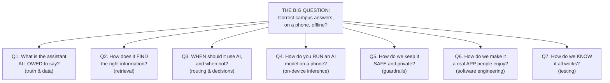
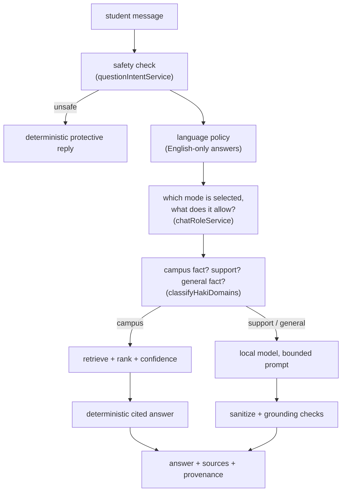
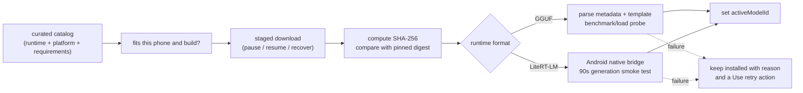
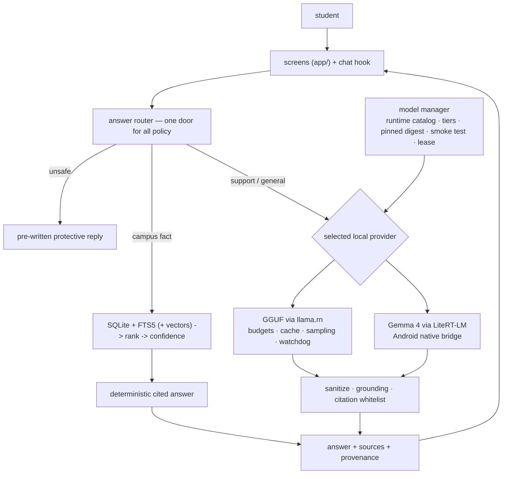

# Building Haki From Scratch

## A Beginner's Guide to On-Device AI Engineering, Taught Through One Big Question

This guide teaches you how Haki works — and how to build it again from nothing — using a method called **decomposition**, which is the heart of systems thinking:

> Take one question that is too big to answer.
> Break it into smaller questions.
> Break those into even smaller questions.
> Keep going until each question is so small you can answer it directly.
> Then walk back up the tree, and the big answer assembles itself.

This is not just how the guide is written. It is how Haki was actually engineered, and it is how most real software gets built. If you learn one thing from this document, learn the habit of asking *"what smaller question is hiding inside this one?"*

The guide reflects the codebase as of June 2026 (HD mascot, theme system, Gemma catalog, the full local-AI pipeline). When the code changes, update this guide with it.

---

## How To Read This Guide

Every chapter is one branch of a question tree. The root question is:

> **"How do we build an assistant that answers students' campus questions correctly, on their own phone, even without internet?"**

That question is impossible to answer directly. So we split it:



Each chapter then breaks its question down further until the answers become small and concrete, and ends with a **"walking back up"** summary that shows how the small answers combine. Chapter 9 is the build manual: the exact order to assemble everything from an empty folder.

**Why this order matters:** notice that "run an AI model" is question number four, not one. Most beginners start with the model. Haki's most important engineering decision is that the model is one worker in an office, not the office itself.

---

## Table of Contents

1. [Q1 — What Is the Assistant Allowed To Say?](#chapter-1)
2. [Q2 — How Does It Find the Right Information?](#chapter-2)
3. [Q3 — When Should It Use AI, and When Not?](#chapter-3)
4. [Q4 — How Do You Run an AI Model on a Phone?](#chapter-4)
5. [Q5 — How Do We Keep It Safe and Private?](#chapter-5)
6. [Q6 — How Do We Make It a Real App?](#chapter-6)
7. [Q7 — How Do We Know It All Works?](#chapter-7)
8. [The Map of the Codebase](#chapter-8)
9. [Building It Back Up: From Empty Folder to Haki](#chapter-9)
10. [The Lessons, the Glossary, and the Honest Limits](#chapter-10)

---

<a name="chapter-1"></a>
# Chapter 1 — Q1: What Is the Assistant Allowed To Say?

Before writing any code, we hit a question that decides everything else.

## Breaking it down

```text
Q1. What is the assistant allowed to say?
├── Q1.1 What happens if it makes things up?
├── Q1.2 Where does "true" information come from?
├── Q1.3 How do we store truth so a program can use it?
└── Q1.4 Which data in the app is official, and which is decoration?
```

### Q1.1 What happens if it makes things up?

> 📂 **Read the code:** `AGENTS.md` (the written rules) · `src/services/answerContractService.ts` (the rules as code)

Small answer: **people get hurt in real life.** If Haki invents "pay PHP 100 at Window 3 before Friday," a student wastes a trip, money, or a deadline. A language model is a *very confident autocomplete* — it produces text that sounds right, which is exactly what makes a wrong answer dangerous.

**Analogy:** a friendly student volunteer is great at encouragement, but you should read enrollment instructions from the registrar's official paper, not from the volunteer's memory.

This single answer creates Haki's core rule, written down before any feature:

> Official campus facts must come from saved documents. The AI model is never the authority for procedures, fees, offices, or deadlines.

### Q1.2 Where does "true" information come from?

> 📂 **Read the code:** `src/data/seed-documents.json` (the verified content) · `src/db/seed.ts` (`SEED_VERSION` + loading it into the database)

Small answer: from **documents that a human verified** — clinic procedures, OSA processes, safety guidelines. Software cannot create truth; it can only store and retrieve what people approved. This is why `src/data/seed-documents.json` exists and why changing it requires bumping `SEED_VERSION` in `src/db/seed.ts` (so phones that already installed the app reload the new content).

### Q1.3 How do we store truth so a program can use it?

> 📂 **Read the code:** `src/types/document.ts` (the chunk shape) · `src/data/seed-documents.json` (real chunks) · `src/services/documentImportService.ts` (how admins add more, with validation)

A whole document is too big to be an answer. So we break documents the same way we break questions: into **chunks** — small, labeled pieces that each answer one thing.

**Analogy:** instead of rereading every binder in a filing room, you prepare index cards: "Lost ID replacement," "Dental consultation," "How to file a complaint." Each card says which binder and page it came from.

```ts
// src/types/document.ts (simplified)
type DocumentChunk = {
  chunk_id: string;        // the card's unique number
  section_title: string;   // what the card is about
  content: string;         // the searchable text
  answer?: string;         // the polished student-facing answer
  citation?: string;       // which document/page this came from
  office?: string;         // who owns this process
  tags?: string[];         // extra search hooks
  steps?: string[];        // numbered procedure, when applicable
};
```

The `citation` field is the receipt. Every official answer Haki gives can show its receipt — and in the chat UI, tapping a source card opens the full procedure in the Service Desk.

### Q1.4 Which data is official, and which is decoration?

> 📂 **Read the code:** `src/data/studentTips.ts` · `src/data/canteenStores.ts` · `src/data/orgChart.ts` · `src/data/campusMapDestinations.ts` · `src/data/libraryTopics.ts` (derived from the official chunks — note how it is the only one built FROM seed data)

An app contains lots of data that is *not* an official answer source. Haki draws a hard line called the **trust boundary**:

| Data | Used for | Trusted as official? |
| --- | --- | --- |
| `seed-documents.json` chunks | Campus answers in chat + Service Desk | **Yes — the only answer source** |
| `studentTips.ts` | Tips bulletin board | No — student-authored advice |
| `canteenStores.ts` | Canteen browsing | No — replaceable menu data |
| `orgChart.ts` | Org chart screen (marked "SAMPLE DATA") | No — placeholder structure |
| `campusMapDestinations.ts` | Map game | Locations confirmed, room data limited |
| Model-generated text | Conversation, support, general facts | **Never for campus facts** |

## Walking back up Q1

The assistant is allowed to say three kinds of things, and each kind has a different authority:

```text
1. Campus facts        -> read from verified chunks, with citations  (authority: documents)
2. Support & chat      -> generated by a local model, bounded        (authority: model, guarded)
3. App/safety replies  -> written by us, deterministic               (authority: the code)
```

Everything else in this guide exists to enforce this three-way split.

---

<a name="chapter-2"></a>
# Chapter 2 — Q2: How Does It Find the Right Information?

We have truth stored as chunks. Now: a student types *"where do I go if I lost my ID?"* — how does the app find the lost-ID chunk?

## Breaking it down

```text
Q2. How does it find the right information?
├── Q2.1 Where do chunks live on the phone?
├── Q2.2 How do we search text fast?
├── Q2.3 What if the student's words don't match the document's words?
├── Q2.4 Several chunks match — which one wins?
├── Q2.5 Is the winner actually good enough to show?
└── Q2.6 What about questions with the same MEANING but totally different words?
```

### Q2.1 Where do chunks live? → SQLite

> 📂 **Read the code:** `src/db/schema.ts` (table definitions) · `src/db/database.ts` (open & configure) · `src/db/migrationRunner.ts` (versioned upgrade scripts) · `src/db/documentRepository.ts` (read/write chunks)

Small answer: in **SQLite**, a tiny database engine that lives inside the app like a filing cabinet bolted to the floor. No server, no internet. The schema includes source documents/chunks, FTS indexes, embedding vectors/status/index metadata, conversation memory, bookmarks, and app metadata. (`src/db/schema.ts`, `src/db/database.ts`, `src/db/migrationRunner.ts`)

Databases on phones must survive app updates, so changes to table shapes go through **migrations** — numbered upgrade scripts, like renovation steps for the filing cabinet that never throw away the existing files.

### Q2.2 How do we search text fast? → FTS5

> 📂 **Read the code:** `src/retrieval/FTSRetriever.ts` (FTS query strategies) · `src/db/ftsHealth.ts` (index health check & repair)

Reading every chunk for every question would be slow. SQLite has **FTS5** (Full-Text Search), which is a pre-built index — like the index pages at the back of a textbook. You don't scan the book; you look up the word and jump to its pages. Database triggers keep the index in sync whenever chunks change. (`src/retrieval/FTSRetriever.ts`, `src/db/ftsHealth.ts`)

### Q2.3 Words don't match? → normalize and expand

> 📂 **Read the code:** `src/retrieval/queryNormalizer.ts` (lowercase, strip punctuation, drop stop-words) · `src/retrieval/synonymIndex.ts` (hand-written alias list)

Students say "lost my ID"; the document says "ID replacement." Two fixes, both boring and both essential:

- **Normalization** (`queryNormalizer.ts`): lowercase, strip punctuation, drop useless words ("the", "po") while keeping domain words.
- **Synonyms** (`synonymIndex.ts`): a hand-written alias list. "lost ID" also searches "replacement". "clinic" also searches "medical".

**Analogy:** a librarian who knows that a student asking for "the nurse's office" means the clinic.

### Q2.4 Which match wins? → ranking

> 📂 **Read the code:** `src/retrieval/ranking.ts` (score candidates by relevance + metadata)

FTS returns several candidates. `ranking.ts` scores them using lexical relevance plus metadata (does the office match the question's scope? does the chunk have a prepared `answer`?). The first database hit is *not* automatically the best one.

### Q2.5 Is the winner good enough? → confidence

> 📂 **Read the code:** `src/retrieval/confidence.ts` (high/medium/low evidence classifier) · `src/services/sourceAnswerService.ts` (office-scope mismatch checks)

This is the question beginners skip, and it is the difference between a toy and a trustworthy product. `confidence.ts` classifies the evidence as high/medium/low. Weak evidence does **not** get presented as an official answer — Haki instead asks one clarifying question or honestly says the information is not saved yet.

> A wrong-but-confident answer is worse than one short question.

`sourceAnswerService.ts` also checks mismatches: a registrar-style question that retrieved a Student Affairs chunk gets stopped, not shown.

### Q2.6 Same meaning, different words? → embeddings (optional)

> 📂 **Read the code:** `src/retrieval/VectorRetriever.ts` (vector similarity search) · `src/retrieval/HybridRetriever.ts` (merge FTS + vector results) · `src/retrieval/rrf.ts` (Reciprocal Rank Fusion algorithm) · `src/db/chunkEmbeddingBackfill.ts` (background embedding worker)

Sometimes no word overlaps: *"my tooth hurts"* vs *"dental consultation."* The fix is **embeddings**: a small AI model converts text into a list of numbers (a vector) where similar meanings land near each other.

**Analogy:** every sentence gets a GPS coordinate in "meaning-space." "My tooth hurts" and "dental consultation" park in the same lot even though they share no words.

```text
each chunk --> embedding model --> vector, stored in chunk_embeddings
new question --> same model    --> query vector
similarity = how close the vectors are (cosine)
```

Haki then merges the two ranked lists — word-based (FTS) and meaning-based (vectors) — with **Reciprocal Rank Fusion** (`rrf.ts`), a beautifully simple rule: items that rank high on *either* list rank high overall.

Two engineering choices to notice:

1. **Embeddings are optional.** FTS works on every phone with no model. The app must never require the fancy path. (`VectorRetriever.ts`, `HybridRetriever.ts`)
2. **Embedding work is a background chore.** `chunkEmbeddingBackfill.ts` computes vectors only after the app has been idle ~30 seconds, pauses whenever the chat is using the model, and stops if the phone is hot. Background work must never make the user's foreground work slower.

## Walking back up Q2

```text
"where do I go if I lost my ID?"
   -> normalize + synonyms              (Q2.3)
   -> FTS5 lookup in SQLite             (Q2.1, Q2.2)
   -> (optional) vector search + fusion (Q2.6)
   -> rank candidates                   (Q2.4)
   -> confidence gate                   (Q2.5)
   -> a chunk we can SHOW, or an honest "let me clarify"
```

Notice: **no language model was needed to find truth.** Retrieval is the dependable floor of the whole product.

---

<a name="chapter-3"></a>
# Chapter 3 — Q3: When Should It Use AI, and When Not?

We can find evidence. We will soon be able to generate text. Who decides which to use for each message?

## Breaking it down

```text
Q3. When should it use AI, and when not?
├── Q3.1 What KINDS of questions exist?
├── Q3.2 Who decides, and where does that code live?
├── Q3.3 Why are official answers built WITHOUT the model?
├── Q3.4 What are the four chat modes, and why have modes at all?
└── Q3.5 What happens when the needed ability is missing?
```

### Q3.1 What kinds of questions exist?

> 📂 **Read the code:** `src/services/questionScenarioService.ts` (classify question into scenario types) · `src/services/questionIntentService.ts` (detect unsafe intents) · `src/services/answerService.ts` (`classifyHakiDomains` domain split)

Classify first, act second. Haki's router recognizes, roughly:

| Kind | Example | Correct handler |
| --- | --- | --- |
| Campus procedure | "How do I get a good moral certificate?" | Retrieval → deterministic answer |
| Emotional support | "I'm so stressed about finals" | Local model, bounded prompt |
| General knowledge | "What is photosynthesis?" | Local model, "verify facts" notice |
| Unsafe request | self-harm, harassment, cheating... | Deterministic protective reply — **never** the model |
| App/profile question | "What can you do?" | Deterministic, written by us |
| Ambiguous | "How do I get it?" | One short clarification question |

### Q3.2 Who decides? → one central router

> 📂 **Read the code:** `src/services/answerService.ts` (the single entry point `answerStudentQuestion`) · `src/services/chatRoleService.ts` (role scope rules) · `src/services/replyLanguageService.ts` (language policy) · `src/services/questionIntentService.ts` (safety gate)

All policy lives behind **one function**: `answerStudentQuestion(...)` in `src/services/answerService.ts`. Screens never decide AI behavior themselves.

**Analogy:** a hospital triage desk. Patients don't wander into operating rooms; one trained person routes everyone. If routing rules were scattered across every hallway, no one could check they're followed.



This is the single most useful **software** engineering idea in the project: *put behavior policy in one testable place.*

### Q3.3 Why are official answers built WITHOUT the model?

> 📂 **Read the code:** `src/services/sourceAnswerService.ts` (`buildDeterministicSourceResponseFromDraft`) · `src/services/searchResultText.ts` (format raw chunk text) · `src/services/sourceChunkAdapter.ts` (adapt DB rows to answer drafts)

The textbook pattern is RAG (Retrieval-Augmented Generation): retrieve documents, hand them to the model, let the model write the answer. Haki deliberately does **less**:

```text
classic RAG:   documents -> LLM rewrites -> answer   (fluent, but can add "pay PHP 100")
Haki official: documents -> rank -> confidence -> format directly -> answer + citation
```

The model never touches the official path. Formatting a retrieved chunk is deterministic: same input, same output, testable, works with zero models installed, costs no battery. The trade is elegance for truthfulness — the right trade when a wrong fee is a real-world harm. (`sourceAnswerService.ts → buildDeterministicSourceResponseFromDraft`)

> Interview-ready sentence: "It is a retrieval-grounded assistant. For high-trust campus answers it uses retrieval-augmented **deterministic** response construction instead of generative paraphrasing — a reliability choice, not a missing feature."

### Q3.4 Why four modes?

> 📂 **Read the code:** `src/components/chat/ChatRoleSelector.tsx` (the mode picker UI) · `src/services/chatRoleService.ts` (per-mode capability rules) · `src/services/modeSelectionService.ts` (auto-select best available mode)

Different jobs need different rules, and users deserve to know which rules are active. The selector (`ChatRoleSelector.tsx`) offers:

| Mode (display name) | Internal id | May answer | Must never |
| --- | --- | --- | --- |
| **All-Around** (default) | `haki` | Orchestrates everything below | Invent campus facts |
| **Campus Only** | `information_officer` | Saved campus info only | Personal advice, outside facts |
| **Listener** | `friendly_buddy` | Kind personal support | Claim credentials, diagnose, give campus facts |
| **Study Helper** | `researcher` | General knowledge | Campus procedures, counseling |

Display names are simple on purpose; internal ids stay stable because services and tests key off them. When a mode is asked something outside its scope, it does not quietly answer — it offers a one-tap "Switch to … and answer" action.

### Q3.5 What if the ability is missing?

> 📂 **Read the code:** `src/ai/FallbackProvider.ts` (the no-model provider) · `src/ai/CapabilityDetector.ts` (detects what modes are safe to offer) · `src/services/modeSelectionService.ts` (picks the safest available mode)

Listener and Study Helper need a downloaded model. Without one, they explain how to set it up — they never pretend another mode answered. Campus answers keep working forever, model or not. **Degrading gracefully is a designed feature, not an accident.**

## Walking back up Q3

The router answers Q3 in one sentence: *classify every message first; send campus facts to retrieval, conversation to the bounded model, danger to fixed replies; and make all of it survive having no model at all.*

---

<a name="chapter-4"></a>
# Chapter 4 — Q4: How Do You Run an AI Model on a Phone?

This is the chapter you asked to study hardest. A server engineer rents a GPU; a mobile AI engineer inherits whatever phone the student owns — 4GB or 16GB of RAM, hot or cold, plugged in or at 12% battery. Everything in this chapter exists because of that.

## Breaking it down

```text
Q4. How do you run an AI model on a phone?
├── Q4.1 What IS a model file, physically?
├── Q4.2 How does a model fit in a small phone? (quantization)
├── Q4.3 Will THIS model fit THIS phone? (tiers & tolerance)
├── Q4.4 How does the model get onto the phone safely? (download pipeline)
├── Q4.5 How does generation actually work? (prefill, decode, KV cache)
├── Q4.6 How do we make it fast? (threads, backends, cache reuse)
├── Q4.7 How do we fit the conversation in its memory? (token budgets)
├── Q4.8 How do we keep output sane? (sampling, stop words, retries)
├── Q4.9 What if it stalls, overheats, or the user gives up? (watchdogs)
└── Q4.10 Who gets the model when two features want it? (leases)
```

### Q4.1 What is a model file, physically?

> 📂 **Read the code:** `src/ai/localModelManager.ts` (runtime-aware file lifecycle) · `src/ai/modelDownloadConfig.ts` (catalog metadata) · `src/ai/LlamaRnProvider.ts` + `src/ai/llamaRnRuntime.ts` (GGUF through `llama.rn`) · `src/ai/LiteRtLmProvider.ts` + `src/ai/nativeRuntimeAdapters.ts` (LiteRT-LM provider boundary) · `android/app/src/main/java/com/tupt/haki/HakiLiteRtLmModule.kt` (Android bridge)

Small answer: a model is **billions of numbers** (weights) plus metadata that tells a compatible runtime how to execute them. Haki supports two local chat artifact formats:

| Runtime format | Provider | Artifact | Platforms in this project |
| --- | --- | --- | --- |
| `gguf` | `LlamaRnProvider` | Quantized `.gguf` file loaded by `llama.rn`/`llama.cpp` | Android and iOS |
| `litert-lm` | `LiteRtLmProvider` | Packaged `.litertlm` artifact loaded by Google's LiteRT-LM Android runtime | Android only |

The Gemma 4 E2B and E4B catalog entries use LiteRT-LM. They are not GGUF files, are not loaded by `llama.rn`, and are not advertised as usable on iOS because this project has no iOS LiteRT-LM bridge.

The app **never bundles** these files in the APK (a build script literally checks). Models are downloaded later into app-private storage:

```text
models/chat/library.json                                  <- installed set + active model id
models/chat/installed/<model-id>/<artifact-file-name>     <- .gguf or .litertlm artifact
models/chat/installed/<model-id>/manifest.json            <- runtime, limits, validation, evaluation
models/chat/staging/<operation-id>.partial.<extension>    <- resumable download staging
```

### Q4.2 How does it fit? → quantization

> 📂 **Read the code:** `src/ai/localModelMetadata.ts` (`deriveModelMetadata` reads GGUF metadata; manifests also carry runtime-specific fields) · `src/ai/localModelRequirements.ts` (base device tiers) · `src/ai/modelDownloadConfig.ts` (per-artifact RAM, storage, and context requirements)

Original weights are commonly 16/32-bit numbers. **Quantization** stores them with fewer bits — the file and working set shrink, with a possible quality cost. Haki's GGUF catalog uses quantized variants such as `Q4_K_M`. LiteRT-LM artifacts are already prepared for that runtime, so Haki trusts their catalog-declared format and resource requirements instead of trying to parse them as GGUF.

**Analogy:** a paint-by-numbers version of a painting. You keep 16 colors instead of 16 million. From a distance it's clearly the same picture; up close you lose subtle shading. A "Q4_K_M" model in Haki's catalog is exactly this: a 4-bit paint-by-numbers copy that fits in a phone.

### Q4.3 Will THIS model fit THIS phone? → tiers, with humility

> 📂 **Read the code:** `src/ai/localModelRequirements.ts` (base tier table + `MODEL_RAM_TOLERANCE_GB`) · `src/ai/modelDownloadConfig.ts` (model-specific overrides) · `src/ai/deviceHardwareProfile.ts` (OS-reported RAM/storage) · `android/app/src/main/java/com/tupt/haki/HakiDeviceInfoModule.kt` (Android RAM/CPU/thermal) · `modules/haki-device-info/` (iOS native equivalent)

Haki defines conservative **tiers** (`localModelRequirements.ts`):

| Tier | Model size | Needs RAM | Needs free storage |
| --- | --- | --- | --- |
| tiny | 0.5–1.5B params | 4 GB | 3 GB |
| minimum | 1–3B | 6 GB | 4 GB |
| good | 3–4B | 8 GB | 6 GB |
| enhanced | 4–7B | 12 GB | 10 GB |
| flagship | 7–8B | 16 GB | 12 GB |

Three hard-won real-world lessons live here:

1. **Phones lie a little.** An "8GB" phone reports ~7.x GB to apps. So visibility and *manual* activation allow a 1 GB tolerance (`MODEL_RAM_TOLERANCE_GB`), while *automatic* tier recommendation stays conservative. Generosity for the user's explicit choice; caution for the machine's own choice.
2. **A display name is not a resource measurement.** Gemma 4 E2B/E4B use explicit catalog values for estimated working set, minimum RAM, minimum free storage, and context limits. GGUF files use parsed metadata plus the base tier table. The activation decision is based on those runtime-aware requirements, not a name alone.
3. **Platform and bridge support are separate from hardware fit.** A phone can have enough RAM for Gemma and still be unable to run it because the installed Android build lacks `HakiLiteRtLm`. The Haki Models screen disables those cards with an updated-build message; iOS never receives the Gemma cards.
4. **Hardware facts need native code.** RAM, CPU core count, and temperature come from a tiny native module written twice — Kotlin for Android (`android/app/src/main/java/com/tupt/haki/HakiDeviceInfoModule.kt`), Swift for iOS (`modules/haki-device-info/ios/HakiDeviceInfoModule.swift`). JavaScript alone cannot see this.

### Q4.4 How does a model get onto the phone safely? → the installation pipeline

> 📂 **Read the code:** `src/ai/localModelManager.ts` (download, integrity check, manifest, runtime probe, activation) · `src/ai/modelOperationCoordinator.ts` (operation state and inference/mutation leases) · `src/ai/modelDownloadConfig.ts` (immutable URL, artifact filename, runtime, platform, requirements, expected SHA-256) · `src/utils/fileSha256.ts` (streamed hash normalization) · `src/ai/storageForecast.ts` (free-space forecast)

A 2–4 GB download that can corrupt, run out of disk, or be the wrong file is itself an engineering problem. Decompose it:

```text
Q4.4 Safe install?
├── what may be offered?   -> curated catalog: URL, runtime, platform, size, license, requirements
├── what if download dies? -> staging dir + pause/resume + auto-resume on restart
├── is the file intact?    -> streamed SHA-256; compare with the catalog's pinned digest
├── is it structurally valid?
│   ├── GGUF               -> parse metadata + validate the chat-template family
│   └── LiteRT-LM          -> validate extension/catalog contract, then require a native smoke test
├── is it safe HERE?       -> tier check against this phone's reported hardware
└── is it actually usable?
    ├── GGUF               -> load/generate benchmark before activation
    └── LiteRT-LM          -> bounded real-generation activation probe
```



**Analogy:** fitting an engine into a car. Check it fits the engine bay, verify the serial number against the order, start it once in the workshop — only then hand the keys to the driver. (`localModelManager.ts` is the workshop.)

Every catalog artifact is pinned to an immutable repository revision and an expected SHA-256 digest. The Gemma 4 E2B and E4B values come from the official LiteRT-LM Hugging Face repositories' LFS metadata, and downloads must match before installation continues. This protects against corruption and unexpected artifact replacement relative to the pinned manifest; it does not replace publisher signing or release-manifest governance. Runtime/platform gates and a real native generation probe remain separate requirements because a correct file can still be unusable on a particular build or phone.

Download completion is therefore not the same as readiness. A LiteRT-LM model is shown as **IN USE** only when the file exists, its manifest is valid, the Android runtime is available, its smoke test passed, `activeModelId` points to it, and capability selection resolves to `LiteRtLmProvider`. A failed probe leaves the artifact installed with its failure reason and a **Use** retry action.

### Q4.5 How does generation actually work? → prefill, decode, and the KV cache

> 📂 **Read the code:** `src/ai/LlamaRnProvider.ts` (prefill/decode loop, prewarm, KV-cache reuse, `cache_n` logging) · `src/ai/prompts.ts` (stable system-prompt prefix design) · `src/ai/llamaRnRuntime.ts` (thin `llama.rn` wrapper)

The detailed cache controls in this subsection are the **GGUF/`llama.rn` path**. `LiteRtLmProvider` sends the same bounded Haki task/source context through `HakiLiteRtLmModule`; LiteRT-LM owns its internal prefill, decode, and cache implementation, so Haki does not claim `cache_n` visibility or reuse guarantees for that runtime.

This is the single most useful mental model in on-device AI. Generation has **two phases**:

```text
PREFILL: the model READS your whole prompt
         (system rules + history + sources + question)
         -> one big computation, speed limited by prompt LENGTH

DECODE:  the model WRITES the answer one token at a time
         -> a small computation per token, this is what you watch stream in
```

While reading, the model saves its "understanding so far" in a **KV cache** (key/value cache).

**Analogy:** the prompt is a book, the KV cache is your bookmarks and margin notes. If someone hands you the *same book with one new page*, you don't reread it — you use your notes and read only the new page.

The killer optimization follows directly: **if the start of this turn's prompt is byte-identical to last turn's, the runtime skips re-reading it.** So Haki was restructured to keep the prompt prefix stable:

```text
BEFORE (cache useless):                      AFTER (cache reused):
[system: rules + TODAY'S task + profile]     [system: rules only]        <- identical every turn
[history...]                                 [history...]                <- grows at the END only
[user: question]                             [user: task + profile + question]
```

One more trick: when the chat screen opens, `prewarm()` loads the model **and runs a 1-token "priming" completion** containing just the system rules. That pre-fills the KV cache so the student's *first* message only pays for its own new text. The runtime even reports `cache_n` — how many prompt tokens were served from cache — which Haki logs to prove the win.

> This is real AI engineering on small models: you didn't change the model at all, and turn-2+ replies got dramatically faster.

### Q4.6 How do we make it fast? → use the silicon you actually have

> 📂 **Read the code:** `src/ai/localModelPerformance.ts` (backend candidates, performance keys, winner selection) · `src/ai/localModelManager.ts` (`benchmarkCandidate` and `probeModelLoad` in GGUF activation) · `src/ai/localModelEvaluation.ts` (separate post-activation behavioral evaluation from Settings, not the backend benchmark)

```text
Q4.6 Speed?
├── how many CPU threads?  -> ask the OS for core count; use about half
│                             (big.LITTLE phones have slow cores you don't want)
└── CPU or GPU?            -> don't guess. RACE them.
```

For GGUF, activation runs a short CPU benchmark, then tries Metal (iOS) or OpenCL (Android) when available and safe. It keeps acceleration **only if it measured better without a worse thermal result**. The winner is saved as the model's *execution profile*. LiteRT-LM currently uses the Android runtime's CPU backend configuration and records no comparable Haki-side CPU/GPU race; its activation proof is the bounded generation smoke test instead.

### Q4.7 How does the conversation fit? → token budgets

> 📂 **Read the code:** `src/ai/tokenBudget.ts` (reserves output space, prunes history/sources to fit the context window)

A model has a fixed **context window** (its working memory, measured in tokens — word-pieces).

**Analogy:** a carry-on bag. The system rules, history, source excerpts, the question, *and the space reserved for the answer* must all fit in one bag. Pack too much history and there is no room left for the answer.

`tokenBudget.ts` does the packing: it reserves output space first, then prunes the lowest-priority context (oldest history, longest source excerpts) until everything fits — with smaller bags for smaller tiers. Counting uses the model's own tokenizer when available, estimation only as fallback.

### Q4.8 How do we keep output sane? → sampling, stop words, retries

> 📂 **Read the code:** `src/ai/outputQuality.ts` (degeneracy detector + retry) · `src/ai/sanitizeAssistantText.ts` (strips leaked instructions/tags) · `src/ai/llamaStoppedLimit.ts` (detects mid-sentence cutoff) · `src/services/chatContinuation.ts` (stitch continuations without repeats) · `src/ai/LlamaRnProvider.ts` (`safeChatSamplingForScenario`, `STOP_WORDS`)

Small models misbehave in predictable ways. Most low-level controls below live in `LlamaRnProvider`; LiteRT-LM uses its native conversation/sampler API, then returns through the same Haki service-layer grounding and response contracts.

| Problem | Defense | Where |
| --- | --- | --- |
| Boring or chaotic word choice | **Sampling** tuned per scenario (low temperature for facts/code, higher for creative) | `safeChatSamplingForScenario` |
| Doesn't know when to stop | **Stop words** — every model family's end token, including Gemma's `<end_of_turn>` (no pipes!) | `STOP_WORDS` |
| Repeats itself in a loop | Degeneracy detector → **one retry with stricter sampling** | `outputQuality.ts` |
| Leaks its instructions or reasoning tags | Output **sanitizer** strips them; thinking-mode disabled for Qwen3 | `sanitizeAssistantText.ts` |
| Cites sources it never saw | Only citation IDs that were *in the prompt* are accepted | provider post-check |
| Hits the output limit mid-sentence | Marked `incomplete` → UI offers **Continue**, stitched without repeats | `llamaStoppedLimit.ts`, `chatContinuation.ts` |

*Sampling in one sentence:* the model outputs probabilities for the next token; **temperature** controls how adventurous the pick is (0.2 = always the safe choice, 0.9 = creative), and top-k/top-p trim the candidate list before picking.

### Q4.9 What if it stalls, overheats, or the user gives up?

> 📂 **Read the code:** `src/ai/inferenceWatchdog.ts` (GGUF first-token deadline + total cap) · `src/ai/liteRtGenerationGuard.ts` (LiteRT total deadline, abort, and thermal guard) · `src/ai/LlamaRnProvider.ts` and `src/ai/LiteRtLmProvider.ts` (provider integration) · `src/ai/nativeModules.ts` and `android/app/src/main/java/com/tupt/haki/HakiLiteRtLmModule.kt` (thermal/cancellation bridges)

Both local runtimes now have explicit cancellation boundaries, with controls matched to what each native API exposes:

- **The user gives up** → every generation carries an *abort signal*. GGUF calls `stopCompletion()`; LiteRT calls `cancelProcess()` through a request-scoped native cancellation method.
- **The runtime stalls** → GGUF uses `inferenceWatchdog.ts` for a first-token deadline (25s on tiny phones, 15s otherwise) plus a 120s total cap. LiteRT uses `liteRtGenerationGuard.ts` for a 120s total cap around its asynchronous callback API.
- **The phone overheats** → both providers read native thermal state. LiteRT cancels immediately at *critical* and after two consecutive *serious* readings; GGUF stops coherently under the same safety intent. The app also releases model memory whenever it goes to the background.

The LiteRT bridge serializes native generations, associates each one with a request ID, and completes each callback exactly once across success, failure, timeout, thermal cancellation, or user abort. This avoids overlapping conversations and late callbacks mutating a newer request.

### Q4.10 Who gets the model? → the inference lease

> 📂 **Read the code:** `src/ai/localModelManager.ts` (lease counter, `acquireLease`/`releaseLease`, `isLocalModelInferenceBusy`) · `src/db/chunkEmbeddingBackfill.ts` (checks busy flag before embedding work)

The chat, the embedding backfill, and the model manager (delete/replace) all want the model. A simple **lease** (a counter + waiters in `localModelManager.ts`) guarantees: a model is never deleted mid-generation, mutations wait for inference to finish, and background embedding work checks `isLocalModelInferenceBusy()` and politely backs off.

**Analogy:** one microscope in the lab, with a sign-out sheet. Nobody unplugs it while someone's eye is on the lens.

## Walking back up Q4

```text
A phone-sized model is:
  a runtime-compatible artifact   (Q4.1, Q4.2)
  matched honestly to the device   (Q4.3)
  installed through verification   (Q4.4)
  run with its reading cached      (Q4.5)
  on benchmarked silicon           (Q4.6)
  inside a packed token budget     (Q4.7)
  with output disciplined          (Q4.8)
  under watchdogs and thermal care (Q4.9)
  shared through a lease           (Q4.10)
```

None of these steps is glamorous. Together they are the difference between "I called an LLM API" and *on-device AI engineering*.

---

<a name="chapter-5"></a>
# Chapter 5 — Q5: How Do We Keep It Safe and Private?

## Breaking it down

```text
Q5. Safe and private?
├── Q5.1 Who decides a request is dangerous — us or the model?
├── Q5.2 How do we stop invented campus facts from leaking through chat?
├── Q5.3 What does the app remember, and what must it protect?
└── Q5.4 Why one answer language?
```

### Q5.1 Who decides danger? → the code, before the model

> 📂 **Read the code:** `src/services/questionIntentService.ts` (rules-based dangerous-request classifier) · `src/services/refusalResponseBuilder.ts` (pre-written protective responses, including distress resources)

`questionIntentService.ts` classifies dangerous requests (self-harm, violence, harassment, exploitation, academic dishonesty, illegal acts...) with **rules, not the model**, and replies with specific, pre-written protective responses. Reasons:

- rules run instantly, offline, identically on every phone;
- a 1B-parameter model's safety judgment is not dependable;
- pre-written distress responses can be reviewed by humans word-by-word — and for self-harm they point to real help, warmly.

The model only ever sees requests that already passed the gate. Defense-in-depth: classify before, instruct the model during (its prompt also refuses), check output after.

### Q5.2 How do we stop invented campus facts in *chat* modes?

> 📂 **Read the code:** `src/services/answerSourcePolicy.ts` (grounding and source-clarification policy) · `src/services/safeLocalChatService.ts` (bounded local generation) · `src/services/scenarioResponseService.ts` (safe fallback redirects) · `src/ai/LlamaRnProvider.ts` (citation whitelist post-check)

Listener and Study Helper prompts explicitly forbid campus facts — but prompts are requests, not guarantees. So a **grounding check** scans generated output, and a reply that starts stating procedure-like campus details gets replaced with a safe fallback that redirects to Campus Only mode. Plus the citation whitelist from Q4.8: the model cannot invent a receipt.

### Q5.3 What is remembered, and what is protected?

> 📂 **Read the code:** `src/services/historyService.ts` (encrypted relevant-only prior turns) · `src/services/bookmarkService.ts` (encrypted saved answers) · `src/services/privateDataCrypto.ts` (AES-256-GCM and keyed search fingerprints) · `src/services/conversationStateService.ts` (track who is who: user/teacher/office) · `src/services/chatConversationContext.ts` (assemble context for the prompt) · `src/services/studentProfileService.ts` (profile in `expo-secure-store`) · `src/services/chatPrivacySettingsService.ts` (user toggles for what AI may use)

```text
remembered:  limited recent turns; older history fetched ONLY when relevant
             (lexical/scenario match — not "attach everything")
tracked:     who is who (user vs teacher vs office) so follow-ups
             don't swap actors                     (conversationStateService)
protected:   student profile in expo-secure-store;
             recent questions, conversation rows, scopes, and bookmarks
             encrypted with AES-256-GCM before persistence; the key stays in
             expo-secure-store; FTS stores keyed token fingerprints, not text;
             the prompt itself instructs: don't repeat ID/course/section
             unless asked
user rights: "Clear recent chat activity" wipes memory; profile/history
             toggles in settings choose what AI may use
```

**Analogy:** good memory is bringing the one relevant page to the desk — not dumping every notebook you own onto it, and keeping the confidential folder closed unless it's needed.

Privacy is also why on-device AI exists here: Haki does not send conversations to a model server. Encryption at rest reduces exposure from copied app databases and backups, while device compromise, unlocked-device access, screenshots, and exported shares remain real local risks.

### Q5.4 Why English-only answers?

> 📂 **Read the code:** `src/services/replyLanguageService.ts` (detects non-English input, returns a polite redirect before any model call)

A deliberate quality decision: small local models produce unreliable Tagalog/Taglish. Rather than answer badly, Haki detects non-English input and politely redirects to English — enforced in the router (`replyLanguageService.ts`), where it is testable, not buried in a prompt and hoped for.

## Walking back up Q5

Safety is **layered**, and the model is the least-trusted layer: rules decide danger, prompts set boundaries, output checks catch leaks, storage encrypts secrets, and the user holds the delete switch.

---

<a name="chapter-6"></a>
# Chapter 6 — Q6: How Do We Make It a Real App?

This chapter is the software-engineering half of your study. An AI pipeline nobody enjoys using is a science experiment.

## Breaking it down

```text
Q6. A real app?
├── Q6.1 How is the code organized so it doesn't rot?
├── Q6.2 How do screens talk to the AI without owning it?
├── Q6.3 How does a chat UI survive streaming, stopping, failing?
├── Q6.4 How do we theme a whole app (and add dark mode) without repainting it twice?
├── Q6.5 How do we make a mascot feel alive without expensive tools?
└── Q6.6 What small touches make it feel finished?
```

### Q6.1 Organization → layers with one-way dependencies

> 📂 **Read the code:** `app/` (Expo Router screens) · `src/hooks/useChatMessages.ts` (stateful orchestration) · `src/services/` (dozens of focused service files) · `src/retrieval/` (evidence-finding) · `src/ai/` (on-device model pipeline) · `src/db/` (SQLite + migrations + seed) · `src/theme/` (design tokens)

```text
app/            screens (Expo Router: each file = one route, like web pages)
src/components/ reusable UI pieces
src/hooks/      stateful glue (useChatMessages owns the live conversation)
src/services/   business logic — dozens of focused files
src/retrieval/  finding evidence
src/ai/         everything from Chapter 4
src/db/         SQLite, migrations, seeding
src/data/       bundled content + pure data helpers
src/theme/      design tokens
src/utils/      tiny shared tools
```

The dependency arrow points **downward only**: screens → hooks → services → (retrieval / ai / db). The AI layer never imports a screen. That is why the entire mascot could be replaced (twice!) without touching the answer pipeline, and why services can be tested with no UI at all.

Notice the *many small services* pattern: `chatFollowUpDetection.ts`, `replyLanguageService.ts`, `refusalResponseBuilder.ts`... Each file answers one tiny question — the question-decomposition method, fossilized into a folder structure.

### Q6.2 Screens don't own AI → the hook boundary

> 📂 **Read the code:** `src/hooks/useChatMessages.ts` (the only thing the chat screen calls) · `app/chat.tsx` (renders; delegates all logic to the hook)

`useChatMessages.ts` is the only thing the chat screen talks to. It owns: the message list, the optimistic user bubble, calling the router, receiving streamed tokens (batched ~50ms so React isn't re-rendered per token), abort, retry, continuation, feedback. The screen renders; the hook orchestrates; the services decide. Three jobs, three homes.

### Q6.3 A chat UI for an *asynchronous* world

> 📂 **Read the code:** `app/chat.tsx` (all chat UI states: waiting, streaming, stopped, failed) · `src/components/chat/ChatMessageBubble.tsx` (individual message bubble + states) · `src/components/chat/ChatInputBar.tsx` (composer + keyboard handling) · `src/components/chat/ChatSourceCard.tsx` (tap-to-Service-Desk source card) · `src/utils/simpleMarkdown.ts` (hand-written markdown parser)

AI output streams, stalls, fails, and gets canceled — a plain form-submit mentality breaks immediately. The UI therefore has explicit states for: waiting (Haki's feather animation + rotating loading lines), streaming (live bubble), stopped (partial kept), incomplete (Continue button), failed (Retry button). Plus mobile realities: the keyboard must resize the layout (Android `adjustResize`, iOS `KeyboardAvoidingView`), and the floating tab bar hides while typing.

Haki's answers render lightweight **markdown** (bold, italics, bullets, numbered steps) through a ~100-line hand-written parser (`src/utils/simpleMarkdown.ts`) instead of a heavy library — unit-tested, and unrecognized syntax simply renders as plain text, because model output must never crash a renderer.

#### The Service Desk taxonomy

> 📂 **Read the code:** `app/library.tsx` (desk switching, routed searches, office filter reset) · `app/library-topic/[chunkId].tsx` (topic detail route) · `src/data/libraryTopics.ts` (seed-derived topics, desk membership, office aliases) · `src/data/libraryTopics.test.ts` (grouping/filter contracts)

The Service Desk presents the verified campus corpus through four stable counters: **Offices**, **Safety**, **Campus Guidelines**, and **Map Directory**. The Offices counter starts with these filters: **All**, **OSA**, **Registrar**, **Medical Clinic**, **Dental Clinic**, **Guidance**, **Public Assistance / QA**, and **Security / Admin**.

Membership is derived from the seed document's category plus searchable verified fields such as office, title, process name, location, answer text, and tags. Alias rules handle variations such as “Office of Student Affairs,” “quality assurance,” and “campus dental clinic”; the UI does not depend on one exact raw office string. Switching desks or receiving a routed search resets an incompatible office filter to **All**.

### Q6.4 Theming → semantic tokens, with a migration still in progress

> 📂 **Read the code:** `src/theme/palette.ts` (raw color values) · `src/theme/themes.ts` (semantic token sets per mode) · `src/theme/ThemeProvider.tsx` (context provider + `useTheme()` hook) · `src/theme/colors.ts` (legacy alias to the light theme)

Hardcoding colors throughout screens makes every palette change expensive. The target architecture is:

```text
palette.ts   raw colors            ("maroon = #7A0019", "dark surface = #171318")
themes.ts    semantic tokens       ("textPrimary", "card", "accent" — one set per mode)
ThemeProvider/useTheme()           migrated screens consume semantic tokens
```

Dark mode can become *data*, not a rewrite, once every screen consumes semantic tokens. This repository is not there yet: `src/theme/colors.ts` still aliases the light theme for legacy consumers, some screens/components still use raw colors, and dark mode remains an admin-preview capability until the migration is complete. The subtle bugs explain why semantic naming matters: a token like `white` used both for "text on maroon" and "card background" cannot flip safely. **Name colors by role, not by appearance.**

### Q6.5 The mascot — and an honest engineering story

> 📂 **Read the code:** `src/mascot/adapter/HakiMascotCompat.tsx` (stable status-driven entry point) · `src/mascot/hd/HakiHdMascot.tsx` (full-body image + Reanimated motion) · `src/mascot/hd/HakiHdAvatar.tsx` (compact square chat portrait only) · `src/mascot/hd/hdAssets.ts` (status/onboarding/model-operation asset maps) · `src/components/mascot/mascotConfig.ts` (`MascotStatus` contract) · `src/components/mascot/useMascotInteraction.ts` (tap/double-tap/shake gestures)

Haki the bird went through three implementations:

1. **Pixel sprites** — charming, but only 2 frames per mood; felt stiff.
2. **Code-drawn vector rig** (Skia, ~16 layered shapes, a behavior state machine with blinking, idle fidgets, eye-tracking) — technically impressive, visually disappointing. It did not look like the official HD art.
3. **HD images + procedural motion** (current, `src/mascot/hd/`) — one consistent white-polo Haki image per status, plus dedicated onboarding, model-operation, detective, and chat-portrait art. Full-body assets share one portrait canvas; the compact avatar uses a square canvas. Motion remains layered in code: ambient float, breathing, a squash-and-stretch "pop" with crossfade on every mood change, thinking sway, celebration hops, groggy wobble.

```text
HakiMascotCompat: stable status/source facade used across screens
HD_STATUS_IMAGES: every MascotStatus -> dedicated transparent PNG
HakiHdMascot:     full-body image + Reanimated transforms on the UI thread
HakiHdAvatar:     compact chat-bubble portrait + gentle breathing only
gestures kept:    tap bounce, double-tap sleep, shake -> dizzy
```

Two lessons worth keeping for your studies. First: **requirements change; architecture should absorb the change.** Because every screen used one `HakiMascotCompat` component with a stable `status` prop, swapping the entire rendering engine touched call sites almost not at all. Second: **"more engineering" is not "better product."** The vector rig was the most sophisticated code in the app, and deleting it was the correct decision. Attachment to clever code is a bug in the engineer.

### Q6.6 Finishing touches

> 📂 **Read the code:** `src/utils/haptics.ts` (haptic wrapper + user toggle) · `src/services/bookmarkService.ts` (save/unsave answers) · `src/services/shareAnswerService.ts` (system share-sheet with citations) · `app/campus-map.tsx` (Feather Hunt mini-game UI) · `src/data/campusMapCollectibles.ts` (feather positions) · `src/data/campusMapGameplay.ts` (game logic) · `src/services/campusFeatherService.ts` (persistence)

Haptics (one tiny wrapper, `src/utils/haptics.ts`, with a user toggle), accessibility labels and live-regions on streaming answers, reduced-motion support everywhere animation exists, bookmarks for answers (a `bookmarks` table + a Saved section in the Service Desk), system share-sheet export with citations, and a Feather Hunt mini-game on the pixel map — 8 collectible feathers whose positions are *unit-tested to be standable* (`campusMapCollectibles.test.ts`). Even play gets tests.

## Walking back up Q6

A real app = layered code with one-way dependencies + an async-honest UI + design tokens + the humility to delete clever work. The AI made Haki possible; this chapter makes it likable.

---

<a name="chapter-7"></a>
# Chapter 7 — Q7: How Do We Know It All Works?

## Breaking it down

```text
Q7. How do we know?
├── Q7.1 What can break silently in an AI app?
├── Q7.2 What kinds of tests catch what?
├── Q7.3 How do you debug a wrong answer?
└── Q7.4 What can only a real phone tell you?
```

### Q7.1 What breaks silently?

> 📂 **Read the code:** `src/services/answerService.ts` (the router whose behavior must stay correct) · `src/services/answerService.chatRoles.test.ts` (mode-boundary contract tests that catch silent regressions)

AI regressions are *behavioral*: the router answers from the wrong mode, weak evidence is shown as reliable, a prompt edit makes a tiny model leak its instructions. The app still compiles. The demo still works. **Compilation is not correctness.**

### Q7.2 The test pyramid, AI edition

> 📂 **Read the code:** `scripts/golden-retrieval.ts` (frozen expected chunk IDs) · `scripts/chat-scenario-eval.ts` (mode/safety/source-miss behavior contracts) · `scripts/test-edge-cases.ts` (Taglish, distress, hallucination) · `scripts/test-local-model-manager.ts` (catalog/tier/hash/template rules) · `scripts/seed-data-qa.ts` (corpus sanity checks) · `src/**/*.test.ts` (unit tests: watchdog, markdown, feather placement, ranking, RRF)

| Layer | Command | Protects |
| --- | --- | --- |
| Types | `npm.cmd run typecheck` | Contracts between layers |
| Unit (vitest) | `npm.cmd run test:unit` | Pure logic: token budgets, ranking, RRF, sanitizer, watchdog, markdown, feather placement |
| **Golden retrieval** | `npm.cmd run test:golden` | 26 real questions must return the **exact expected chunk IDs** |
| **Scenario evals** | `npm.cmd run test:chat-scenarios` | Mode boundaries, safety refusals, source misses — behavior as a contract |
| Edge cases | `npm.cmd run test:edge-cases` | Taglish redirects, distress handling, hallucination guards |
| Model manager | `npm.cmd run test:local-models` | Catalog groups, runtime/platform gates, tier rules, integrity policy, template validation |
| Everything | `npm.cmd run test:all` | The gate before any release |

Two patterns to copy into your own projects:

- **Golden tests:** freeze known-correct outputs for representative inputs; any drift fails loudly. This is the cheapest honest eval for retrieval systems.
- **Extract pure functions to make AI testable:** the watchdog takes an injectable clock; the markdown parser has no React imports; feather placement is plain math. Deterministic logic gets pulled *out* of the async/native soup precisely so it can be tested in milliseconds.

### Q7.3 Debugging a wrong answer — blame layers in order

> 📂 **Read the code:** `src/retrieval/queryNormalizer.ts` + `synonymIndex.ts` + `FTSRetriever.ts` + `ranking.ts` (retrieval chain) · `src/retrieval/confidence.ts` + `src/services/sourceAnswerService.ts` (confidence gate) · `src/ai/tokenBudget.ts` + `src/ai/llamaStoppedLimit.ts` (output-cut issues) · `src/ai/LlamaRnProvider.ts` (stop words, cache hits)

| Symptom | Look first at |
| --- | --- |
| Right document never found | normalization → synonyms → FTS → ranking → the seed data itself |
| Wrong source shown confidently | confidence gate, office-scope mismatch checks |
| Listener gives a campus procedure | role prompt, domain routing, grounding check |
| Replies slow after turn 1 | prompt-prefix stability (is the cache being missed? check `cache_n` in logs) |
| Output cut mid-sentence | token budget, stopped-limit flag, continuation |
| Gemma never stops talking | stop-word list (`<end_of_turn>`) |
| Model mode missing | manifest rejection reasons, tier check, hardware report |

The discipline: **don't blame the model first.** Most "AI bugs" live in the system around it.

### Q7.4 Only a phone can tell you...

> 📂 **Read the code:** `scripts/inspect-apk-assets.ps1` (verify no model weights bundled in the APK) · `eas.json` (preview build profile) · `src/ai/LlamaRnProvider.ts` (`cache_n` and `prompt_ms` for GGUF) · `android/app/src/main/java/com/tupt/haki/HakiLiteRtLmModule.kt` (real LiteRT-LM bridge)

...whether the keyboard hides the composer, whether streaming feels smooth, whether a 3GB download resumes after a crash, how hot the phone gets, what `prompt_ms`/`cache_n` actually measure for GGUF, and whether the packaged LiteRT-LM native libraries can load Gemma 4 E2B/E4B on the intended Android device. Hence Android compilation/debug builds, preview APK builds (`eas build -p android --profile preview`), and a physical-device activation/chat checklist as final gates. Automated tests protect *logic*; devices validate native execution and experience.

---

<a name="chapter-8"></a>
# Chapter 8 — The Map of the Codebase

A condensed "where does X live" reference while rebuilding.

| Question from this guide | Code |
| --- | --- |
| Truth & chunks (Q1) | `src/data/seed-documents.json`, `src/types/document.ts`, `src/db/seed.ts` |
| Database & FTS (Q2.1–2) | `src/db/{database,schema,migrationRunner,ftsHealth,documentRepository}.ts` |
| Search smarts (Q2.3–5) | `src/retrieval/{FTSRetriever,queryNormalizer,synonymIndex,ranking,confidence}.ts` |
| Meaning search (Q2.6) | `src/retrieval/{VectorRetriever,HybridRetriever,rrf}.ts`, `src/db/chunkEmbeddingBackfill.ts` |
| The router (Q3) | `src/services/{answerService,answerContractService,questionIntentService,questionScenarioService,chatRoleService,replyLanguageService}.ts` |
| Deterministic answers (Q3.3) | `src/services/{sourceAnswerService,searchResultText,sourceChunkAdapter}.ts` |
| Provider contract & mode pick | `src/ai/{LocalAIProvider,CapabilityDetector,modeSelectionPolicy,providerRegistry,FallbackProvider}.ts`, `src/services/modeSelectionService.ts` |
| GGUF runtime (Q4.5–9) | `src/ai/{LlamaRnProvider,llamaRnRuntime,tokenBudget,prompts,sanitizeAssistantText,outputQuality,llamaStoppedLimit,inferenceWatchdog}.ts` |
| LiteRT-LM runtime | `src/ai/{LiteRtLmProvider,nativeRuntimeAdapters,nativeModules}.ts`, `android/app/src/main/java/com/tupt/haki/HakiLiteRtLmModule.kt` |
| Model install & tiers (Q4.3–4) | `src/ai/{localModelManager,localModelMetadata,localModelRequirements,modelDownloadConfig,deviceHardwareProfile,storageForecast}.ts` |
| Native hardware truth | `android/app/src/main/java/com/tupt/haki/HakiDeviceInfoModule.kt`, `modules/haki-device-info/ios/HakiDeviceInfoModule.swift` |
| Memory & privacy (Q5.3) | `src/services/{historyService,conversationStateService,chatConversationContext,studentProfileService,chatPrivacySettingsService}.ts` |
| Chat UI (Q6.2–3) | `app/chat.tsx`, `src/hooks/useChatMessages.ts`, `src/components/chat/*` (incl. `ChatMarkdownText`, `ChatSourceCard` with tap-to-Service-Desk) |
| Service Desk | `app/library.tsx`, `app/library-topic/[chunkId].tsx`, `src/data/libraryTopics.ts` |
| Theme (Q6.4) | `src/theme/palette.ts`, `src/theme/themes.ts`, `src/theme/ThemeProvider.tsx`, `src/theme/colors.ts` |
| Mascot (Q6.5) | `src/mascot/adapter/HakiMascotCompat.tsx`, `src/mascot/hd/HakiHdMascot.tsx`, `src/mascot/hd/HakiHdAvatar.tsx`, `src/mascot/hd/hdAssets.ts`, `src/components/mascot/{mascotConfig,useMascotInteraction}.ts` |
| Map game (Q6.6) | `app/campus-map.tsx`, `src/data/{campusMapGameplay,campusMapCollectibles}.ts`, `src/services/campusFeatherService.ts` |
| Tests (Q7) | `scripts/{golden-retrieval,chat-scenario-eval,test-edge-cases,test-local-model-manager,seed-data-qa}.ts`, `src/**/*.test.ts` |
| Other screens | `app/index.tsx`, `app/library.tsx`, `app/library-topic/[chunkId].tsx`, `app/tips.tsx`, `app/models.tsx`, `app/onboarding.tsx`, `app/profile.tsx`, `app/settings.tsx`, `app/org-chart.tsx`, `app/canteen.tsx`, `app/map.tsx` |

---

<a name="chapter-9"></a>
# Chapter 9 — Building It Back Up: From Empty Folder to Haki

The question tree, now reversed. Build leaf answers first; each step has a checkpoint so you never stack new work on broken work. **The model-provider layer arrives at step 9 of this 15-step sequence — and the app already works at step 6.**

```text
rules -> shell -> data -> database -> retrieval -> answers -> UI -> router
      -> providers -> runtime -> model manager -> semantics -> polish -> proof
```

**Step 0 — Write the rules.** Behavioral contracts on paper before code: campus facts only from sources; generation optional and bounded; English-only answers; deterministic safety; one clarification for ambiguity; conservative model activation; profile privacy. *(Checkpoint: you can say which answers need evidence.)* → later lives in `AGENTS.md`, `src/services/answerContractService.ts`.

**Step 1 — Expo shell.** Expo Router + TypeScript; plugins for SQLite/FTS, voice, file access, `llama.rn`; `@/ → src/` alias. → `app.json`, `package.json`, `babel.config.js`, `tsconfig.json`, `app/_layout.tsx`. *(App launches; routes render.)*

**Step 2 — Navigation, onboarding, profile.** Tabs, first-run flow, profile in secure storage, admin gate, lifecycle handlers (background → release resources). → `app/onboarding.tsx`, `app/profile.tsx`, `src/components/AdminGate.tsx`, `src/services/studentProfileService.ts`, `src/utils/onboardingState.ts`. *(New users onboard; admin stays locked.)*

**Step 3 — Chunk the truth.** Define `DocumentChunk`, author `seed-documents.json` with real verified content + citations. → `src/types/document.ts`, `src/data/seed-documents.json`. *(Every intended answer has a chunk and a receipt.)*

**Step 4 — Database.** SQLite open + migrations + versioned seeding + FTS virtual tables with sync triggers + health check. → `src/db/database.ts`, `src/db/schema.ts`, `src/db/migrationRunner.ts`, `src/db/seed.ts`, `src/db/ftsHealth.ts`, `src/db/documentRepository.ts`. *(Chunks queryable offline; reseed on `SEED_VERSION` bump.)*

**Step 5 — Retrieval.** Normalizer → synonyms → FTS strategies → ranking → confidence. Write the golden test file *now*. → `src/retrieval/queryNormalizer.ts`, `src/retrieval/synonymIndex.ts`, `src/retrieval/FTSRetriever.ts`, `src/retrieval/ranking.ts`, `src/retrieval/confidence.ts`, `src/data/golden-questions.json`, `scripts/golden-retrieval.ts`. *(Golden questions return expected chunk IDs.)*

**Step 6 — Deterministic answers.** Draft → `buildDeterministicSourceResponseFromDraft` → answer + citations + confidence + ambiguity handling. **You now have a working, truthful product with zero AI models.** → `src/services/sourceAnswerService.ts`, `src/services/searchResultText.ts`, `src/services/sourceChunkAdapter.ts`. *(Official questions: cited answer or honest miss.)*

**Step 7 — Chat UI + hook.** Bubbles, input, source cards, mode selector, `useChatMessages` with optimistic updates, streaming plumbing, abort/retry/continue, keyboard handling, markdown rendering. → `app/chat.tsx`, `src/hooks/useChatMessages.ts`, `src/components/chat/ChatMessageBubble.tsx`, `src/components/chat/ChatInputBar.tsx`, `src/components/chat/ChatSourceCard.tsx`, `src/components/chat/ChatRoleSelector.tsx`, `src/utils/simpleMarkdown.ts`. *(UI coherent through every async state.)*

**Step 8 — The router.** Centralize: safety → language → role scope → domain split → source or generation or deterministic reply; mode-switch suggestions; scenario evals written against it. → `src/services/answerService.ts`, `src/services/questionIntentService.ts`, `src/services/questionScenarioService.ts`, `src/services/chatRoleService.ts`, `src/services/replyLanguageService.ts`, `src/services/refusalResponseBuilder.ts`, `scripts/chat-scenario-eval.ts`. *(Behavior is testable as a contract.)*

**Step 9 — Provider interface.** `LocalAIProvider` capabilities contract; `FallbackProvider` (no model — app still answers); capability detection picks the safest available mode. → `src/ai/LocalAIProvider.ts`, `src/ai/FallbackProvider.ts`, `src/ai/CapabilityDetector.ts`, `src/ai/DeviceAIMode.ts`, `src/services/modeSelectionService.ts`. *(No model = graceful; never a crash.)*

**Step 10 — Local runtimes.** Implement the shared provider contract, then add GGUF through `llama.rn` and Android Gemma 4 through LiteRT-LM. The GGUF path owns stable prompt prefixes, prewarm priming, sampling, stop words, streaming/abort, retries, sanitizer, watchdog, thermal checks, and backend benchmarking. The LiteRT-LM path owns native bridge detection, `.litertlm` loading, bounded activation probing, safe chat/summary calls, and release. → `src/ai/LlamaRnProvider.ts`, `src/ai/llamaRnRuntime.ts`, `src/ai/LiteRtLmProvider.ts`, `src/ai/nativeRuntimeAdapters.ts`, `android/app/src/main/java/com/tupt/haki/HakiLiteRtLmModule.kt`. *(A runtime can be absent without taking down source search.)*

**Step 11 — Model manager and Haki Models UI.** Curate runtime/platform/artifact/size/license/requirements/context/activation metadata plus an immutable revision and expected SHA-256; group cards into **Recommended for this phone**, **Other compatible models**, and conditional **Experimental high-RAM** sections. Stage downloads with pause/resume/recovery, verify integrity, build runtime-aware manifests, run the runtime-specific activation probe, refresh capability selection, and only then set `activeModelId`. → `src/ai/localModelManager.ts`, `src/ai/modelDownloadConfig.ts`, `src/ai/modelCatalog.ts`, `src/ai/localModelMetadata.ts`, `src/ai/localModelRequirements.ts`, `src/ai/deviceHardwareProfile.ts`, `src/ai/storageForecast.ts`, `src/ai/localModelPerformance.ts`, `src/ai/modelActivationState.ts`, `src/utils/fileSha256.ts`, `app/models.tsx`, `src/components/models/ModelCatalogSection.tsx`, `scripts/test-local-model-manager.ts`. *(Downloaded-but-failed artifacts remain installed with a reason and retry; “IN USE” requires file, manifest, runtime, evaluation, active id, and selected provider agreement.)*

**Step 12 — Semantic retrieval (optional).** Embedding provider → polite background backfill → vector + RRF hybrid, keyed by `(chunk_id, model_name)`. → `src/retrieval/VectorRetriever.ts`, `src/retrieval/HybridRetriever.ts`, `src/retrieval/rrf.ts`, `src/db/chunkEmbeddingBackfill.ts`, `src/db/sqliteVec.ts`. *(Meaning-matches improve; absence of embeddings changes nothing.)*

**Step 13 — Memory, voice, polish.** Relevant-only encrypted history, keyed private search terms, actor tracking, voice input, feedback, encrypted bookmarks, share, theme tokens + dark mode, HD mascot, haptics, map game. → `src/services/historyService.ts`, `src/services/privateDataCrypto.ts`, `src/services/conversationStateService.ts`, `src/services/chatPrivacySettingsService.ts`, `src/hooks/useVoiceInput.ts`, `src/services/bookmarkService.ts`, `src/services/shareAnswerService.ts`, `src/theme/palette.ts`, `src/theme/featurePalettes.ts`, `src/theme/themes.ts`, `src/theme/ThemeProvider.tsx`, `src/mascot/hd/HakiHdMascot.tsx`, `src/utils/haptics.ts`, `app/campus-map.tsx`, `src/data/campusMapCollectibles.ts`. *(The product feels finished, not assembled.)*

**Step 14 — Proof.** Wire `npm.cmd run test:all`; APK inspection (no bundled weights); Android Kotlin/debug builds; preview build; on-device checklist (keyboard, streaming, stop, download resume, theme coverage, GGUF `cache_n`, Gemma E2B/E4B activation/chat). → `scripts/inspect-apk-assets.ps1`, `scripts/seed-data-qa.ts`, `scripts/test-edge-cases.ts`, `eas.json`, `vitest.config.ts`. *(Green suite + a phone in your hand that behaves.)*

---

<a name="chapter-10"></a>
# Chapter 10 — The Lessons, the Glossary, and the Honest Limits

## 10.1 The ten lessons (your study summary)

1. **Decompose until trivial.** Every chapter of this guide — and every small service file — is the same move: split the question until the answer is obvious, then compose.
2. **Decide what the AI is *not* allowed to do before deciding what it does.** The trust boundary came before any model code.
3. **Retrieval is the floor; generation is the bonus.** The app is useful with zero models installed.
4. **Deterministic beats fluent when the cost of error is real.** Official answers are formatted, not generated.
5. **The model is the least-trusted component in its own pipeline.** Rules before it, bounded prompts inside it, validators after it.
6. **On-device AI is mostly resource engineering.** Quantization, tiers, token budgets, KV-cache reuse, thread counts, benchmarks, thermal care, leases — the model never changed; the system around it did.
7. **Measure, don't assume.** Benchmark CPU vs GPU. Log `cache_n`. Trust effective footprints over parameter names. Allow for phones that under-report RAM.
8. **Centralize policy; scatter nothing.** One router made safety, modes, and language testable.
9. **Name things by role, not appearance** — colors (`textPrimary`, not `white`), modes (stable ids under friendly names), files (one question each).
10. **Be willing to delete your cleverest code.** The vector mascot rig was the most sophisticated module in the repo and the right thing to remove. Swappable architecture (one compat component) made that cheap.

## 10.2 Glossary in plain words

| Term | Plain meaning here |
| --- | --- |
| Offline-first | Core answers work with no internet and no server |
| Chunk | An index card cut from a document, with a citation receipt |
| FTS5 | SQLite's back-of-the-book index for fast text search |
| Embedding | A sentence's GPS coordinate in meaning-space |
| RRF | Merge two ranked lists; reward items high on either |
| Confidence gate | "Is this evidence good enough to show?" — the no-guessing rule |
| GGUF | The single-file format for local model weights |
| LiteRT-LM | Google's local language-model runtime used here through an Android native bridge |
| `.litertlm` | A packaged model artifact consumed by LiteRT-LM; not a GGUF file |
| Runtime format | The manifest/catalog contract that selects the loader and provider |
| Activation smoke test | A real bounded generation call required before a downloaded model becomes active |
| Quantization | Paint-by-numbers compression of weights (~4 bits) |
| Token | A word-piece; the unit of model memory and speed |
| Context window | The model's carry-on bag for prompt + answer |
| Prefill / decode | Reading the prompt / writing the answer, one token at a time |
| KV cache | The model's margin notes — never reread an unchanged prefix |
| Prewarm / priming | Loading the model and pre-reading the system rules before the first message |
| Sampling / temperature | How adventurously the next token is picked |
| Stop word | The token that means "the answer is finished" |
| Watchdog | A timer that kills a stalled generation |
| Inference lease | The sign-out sheet for the one shared model |
| Tier | A conservative "will it fit this phone" class |
| Grounding check | Catching campus-fact leaks in generated text |
| Golden test | Frozen known-correct outputs that fail loudly on drift |

## 10.3 Honest limits (knowing them is senior engineering)

| Limit | Why it matters | Sensible next step |
| --- | --- | --- |
| Truth is only as good as the seeded corpus | Retrieval cannot repair stale documents | Document ownership + update pipeline (planned: signed update packages) |
| Org chart and some display data are samples | Must not read as official | Replace with verified data; keep the SAMPLE badge until then |
| Vector search scans embeddings in memory | Fine for dozens of chunks, not thousands | Adopt a real vector index when the corpus grows |
| Tiny models stay tiny | Safeguards bound the harm, not the awkwardness | On-device evals before promoting new catalog models |
| "Offline AI" starts after one download | Network + storage needed once | Keep source-only mode first-class forever |
| Apple/GPU paths need physical-device validation | Simulators don't sweat | Device-matrix testing before each release |
| Gemma 4 support is Android-only | No iOS LiteRT-LM bridge exists in this project | Keep cards hidden on iOS; add and test a real bridge before advertising support |
| Pinned Gemma hashes depend on upstream repository governance | A matching digest proves the file matches Haki's pinned manifest, not the publisher's identity | Add a signed release manifest or controlled artifact mirror before broad production distribution |

## 10.4 The whole system on one page



Read it bottom-up one last time: verified data, found honestly, routed deliberately, generated carefully, guarded constantly, shipped with proof. That is the whole of Haki — and now you can build it again.
